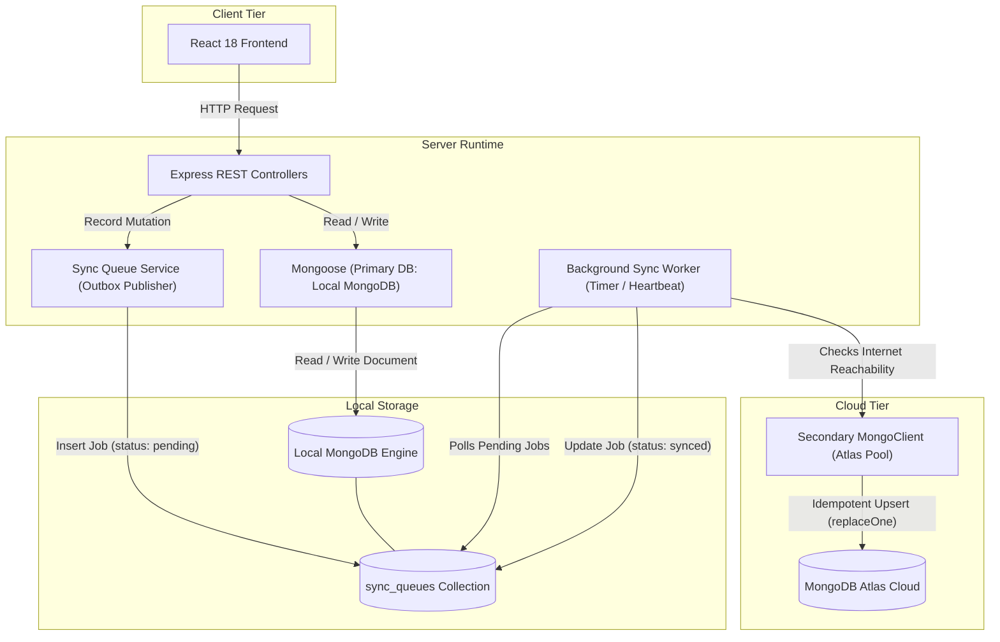

# FestFlow Offline-First Architecture Audit & Synchronization Strategy

**Project Name:** FestFlow — College Event Management System  
**Repository Location:** `C:\Users\sathy\FestFlow`  
**Audit Date:** November 1, 2026  
**Primary Target:** Offline-First Operation via Local MongoDB with Automated Persistent Sync to MongoDB Atlas  

---

## 1. Executive Summary & Objective

The objective of this architecture audit is to transition FestFlow from a purely cloud-dependent deployment (direct MongoDB Atlas reliance) into an **Offline-First, Resilient College Event Management System**. 

In high-density campus environments—such as auditoriums, open grounds, sports complexes, and basement labs—internet connectivity is notoriously unstable or intermittent. Event registrations, QR-code ticket scans, volunteer task tracking, and cash/counter payments must not stall or fail due to network outages.

### Target Architecture Paradigm
```text
┌─────────────────────────┐
│     Client Browsers     │  (Student Laptops, Organizer Tablets, Venue Kiosks)
└────────────┬────────────┘
             │ HTTP / JSON REST APIs
             ▼
┌─────────────────────────┐
│  Node.js / Express App  │  (Running on Campus Server / Laptop / Local Host)
└────────────┬────────────┘
             │ Zero-latency localhost read/writes (< 5ms)
             ▼
┌─────────────────────────┐
│      LOCAL MONGODB      │  ◄── PRIMARY SOURCE OF TRUTH FOR OPERATIONAL SYSTEM
│   (Standalone / Local)  │
└────────────┬────────────┘
             │ Writes mutation event (Outbox Pattern)
             ▼
┌─────────────────────────┐
│  PERSISTENT SYNC QUEUE  │  (Stored in Local MongoDB `sync_queues` Collection)
└────────────┬────────────┘
             │ Asynchronous Background Sync Worker
             │ (Heartbeat Detection, Batched Upserts, Exponential Backoff)
             ▼ (When Internet is Available)
┌─────────────────────────┐
│   MONGODB ATLAS CLOUD   │  ◄── CENTRALIZED REPOSITORY & DISASTER RECOVERY
└─────────────────────────┘
```

This audit provides a comprehensive codebase inspection of FestFlow, analyzes failure points, and details an implementation plan with zero breaking changes to existing business logic.

---

## 2. Current Architecture & Atlas Connection Audit

### 2.1 How Atlas is Currently Connected
Currently, FestFlow establishes a **single default Mongoose connection** at backend boot:
- **Configuration File:** `server/src/config/db.js`
- **Environment Variable:** `MONGODB_URI` read from `server/.env`
- **Boot Sequence:** In `server/src/server.js` (lines 92–97):
  ```javascript
  connectDB().then(() => {
    server = app.listen(PORT, () => {
      console.log(`🚀 FestFlow Server running on port ${PORT}...`);
    });
  });
  ```
- **Crash-on-Failure Vulnerability:** In `server/src/config/db.js` (lines 25–28):
  ```javascript
  } catch (error) {
    console.error(`❌ MongoDB Connection Failed: ${error.message}`);
    process.exit(1); // Terminates entire Node process if Atlas is unreachable!
  }
  ```
- **Critical Finding:** If `MONGODB_URI` points to MongoDB Atlas and the local machine loses internet connectivity on startup, the entire backend server immediately crashes with code 1. Furthermore, if the internet drops during runtime, any active Mongoose operation blocks until the connection pool times out (default 30,000ms), causing client-side request freezes and `504 Gateway Timeout` errors.

### 2.2 Frontend API & State Handling
- **API Client:** `client/src/api/client.js` uses Axios with baseURL `/api`.
- **Token Management:** JWT is stored in `localStorage` (`festflow_token` and `festflow_user`).
- **Session Verification:** `client/src/context/AuthContext.jsx` issues a `GET /api/auth/me` call on page reload. If the backend is running locally, this verification succeeds instantaneously regardless of external internet access.
- **Error Behavior:** Currently, 401 errors clear `localStorage`. Network errors reject the promise and are caught by component catch blocks, displaying generic error toasts or alerts. There is currently no UI indicator reflecting network or synchronization status.

---

## 3. Comprehensive Codebase Inspection by Module

### 3.1 Mongoose Models & Schemas
FestFlow defines 14 core database models across `server/src/models/`:

| Model File | Collection Name | Key Schema Fields & Indexes | Relational Dependencies |
| :--- | :--- | :--- | :--- |
| `User.js` | `users` | `email` (unique), `password` (bcrypt), `role`, `clubs` | Referenced by all operational entities |
| `Club.js` | `clubs` | `name` (unique), `organizers`, `facultyCoordinator` | `User` (as organizers and coordinators) |
| `ClubMembership.js` | `clubmemberships` | Compound index `{ club: 1, user: 1 }` (unique) | `Club`, `User` |
| `Event.js` | `events` | `title`, `club`, `venue`, `maxParticipants`, `registrationDeadline` | `Club`, `Venue`, `User` (`createdBy`, `organizers`) |
| `Venue.js` | `venues` | `name` (unique), `capacity`, `facilities` sub-documents | Referenced by `Event` |
| `Registration.js` | `registrations` | `ticketNumber` (unique), compound `{ user: 1, event: 1 }` (unique) | `User`, `Event` |
| `Payment.js` | `payments` | `transactionId` (unique), `amount`, `paymentStatus` | `Registration`, `Event`, `User` |
| `Finance.js` | `budgets`, `expenses`, `revenues` | `event`, `amount`, `approvalDate`, `revenueType` | `Event` |
| `Feedback.js` | `feedback` | Compound `{ event: 1, user: 1 }` (unique), `rating` (1–5) | `Event`, `User` |
| `Certificate.js` | `certificates` | `certificateNo` (unique), `verificationCode` (unique) | `Event`, `User` |
| `Volunteer.js` | `volunteers` | Compound `{ event: 1, user: 1 }` (unique), `assignedTask` | `Event`, `User` |
| `Sponsor.js` | `sponsors`, `eventsponsors` | Sponsor profiles and event linkage | `Event`, `Sponsor` |
| `Catering.js` | `caterings` | `event`, `catererName`, `menu` embedded items | `Event` |
| `Competition.js` | `competitions`, `competitionteams`, etc. | `event`, team limits, judging scores | `Event`, `User` |

### 3.2 Authentication & Authorization Logic
- **Hashing:** User passwords are encrypted using `bcryptjs` with salt rounds = 10 (`server/src/models/User.js`).
- **Token Generation:** `jwt.sign({ id }, process.env.JWT_SECRET)` (`server/src/controllers/authController.js`).
- **Token Verification:** `server/src/middleware/authMiddleware.js` extracts the Bearer token, verifies it against `JWT_SECRET`, and queries `User.findById(decoded.id)`.
- **Finding:** Authentication is **100% self-contained within Node.js and MongoDB**. It has zero dependencies on external OAuth providers (Google/GitHub) or third-party auth services (Auth0/Firebase). Therefore, **offline authentication against Local MongoDB works natively without modification**.

### 3.3 Event Registration Workflow
- Handled in `server/src/controllers/registrationController.js` (`registerForEvent`):
  1. Validates that the event exists and has status `'published'` or `'ongoing'`.
  2. Verifies current time $\le$ `registrationDeadline`.
  3. Checks duplicate registration via `Registration.findOne({ user: req.user.id, event: event._id })`.
  4. Checks capacity via `Registration.countDocuments({ event: event._id, registrationStatus: { $ne: 'cancelled' } }) < event.maxParticipants`.
  5. Generates unique ticket number: `FF-${Date.now().toString(36).toUpperCase()}-${random}`.
  6. Creates the registration document and populates event and user details.
- **Finding:** Because all steps are atomic queries against MongoDB collections, this entire workflow functions completely offline if directed to Local MongoDB.

### 3.4 Club Management & Permissions
- Implemented in `server/src/utils/clubAuthorization.js` (`getAuthorizedClubIds`, `getSupervisedClubIds`, `isAuthorizedForClub`).
- Permissions evaluate:
  - Admin: blanket access to all clubs.
  - Faculty: checks `Club.facultyCoordinator.user` and `ClubMembership`.
  - Organizer: checks `User.clubs`, `Club.organizers`, and active `ClubMembership` officer roles.
- **Finding:** All permission calculations query `Club` and `ClubMembership` collections locally. Offline execution produces identical security evaluations as cloud execution.

### 3.5 Finance & Payment Processing
- `server/src/controllers/paymentController.js` creates a `Payment` document with a unique `transactionId: TXN-...` and status `'completed'`.
- Automatically logs a corresponding `Revenue` entry in the `revenues` collection.
- In `server/src/controllers/financeController.js`, organizers and faculty create budgets and expenses, and faculty approves/rejects budgets.
- **Finding:** FestFlow currently simulates transaction IDs internally without an active external banking gateway webhook. Offline transaction logging is completely safe and valid.

### 3.6 Seed Scripts & Test Suites
- **Seed Scripts:** `server/src/utils/seedData.js` and `server/src/utils/seedAdditionalModules.js` populate standard clubs, users, venues, and events.
- **Test Suites:** `server/tests/permissions.test.js`, `server/tests/faculty_and_clubs.test.js`, and `tests/healthcheck.js` execute direct API invocations against the running server.
- **Finding:** Tests run against `PORT=5000` via localhost. Pointing the server to Local MongoDB will allow all existing tests to pass without internet.

---

## 4. Key Architectural Questions & Findings

### Q1: How is Atlas currently connected?
Atlas is connected via a single global Mongoose connection instance initialized in `server/src/config/db.js` using `process.env.MONGODB_URI`. If the connection fails or internet drops, the server terminates immediately.

### Q2: Which files need modification?
To implement the offline-first architecture cleanly without breaking existing logic:
1. `server/.env.example` & `server/.env`: Add `LOCAL_MONGODB_URI`, `CLOUD_MONGODB_URI`, and sync control variables.
2. `server/src/config/db.js`: Establish default Mongoose connection to Local MongoDB, and configure an isolated secondary connection client for MongoDB Atlas.
3. `server/src/models/SyncQueue.js` **[NEW]**: Schema for persistent mutation events.
4. `server/src/services/syncQueueService.js` **[NEW]**: Helper service to enqueue document mutations (inserts/updates/deletes) atomically.
5. `server/src/services/syncWorker.js` **[NEW]**: Background worker that monitors internet reachability to Atlas, drains the queue, and executes idempotent upserts to Atlas.
6. `server/src/server.js`: Initialize the sync worker upon local database connection; handle graceful shutdown.
7. `server/src/routes/syncRoutes.js` & `server/src/controllers/syncController.js` **[NEW]**: Provide `/api/sync/status` and `/api/sync/trigger` endpoints for monitoring sync health.
8. `client/src/components/SyncStatusBadge.jsx` **[NEW]**: Visual indicator in the navbar showing "Offline Mode" or "Cloud Synced".

### Q3: Which collections need local-to-cloud synchronisation?
All 14 business collections require local-to-cloud sync to ensure Atlas mirrors all campus activity:
- High-Frequency / Critical: `registrations`, `payments`, `users`, `events`.
- Financial & Governance: `budgets`, `expenses`, `revenues`, `clubs`, `clubmemberships`.
- Operational & Engagement: `feedback`, `certificates`, `volunteers`, `sponsors`, `eventsponsors`, `caterings`, `venues`, `competitions`, `competitionteams`, `competitionrounds`, `judgingscores`.

### Q4: Which operations can safely work offline?
- User authentication and role-based login (for existing local accounts).
- Browsing all events, clubs, venues, and schedules.
- Creating, editing, and publishing events by organizers.
- Student event registration and instant ticket generation.
- Scanning QR codes for attendee check-in.
- Recording cash/counter payments and auto-logging event revenue.
- Adding expense records and submitting budget approval requests.
- Submitting post-event feedback and ratings.
- Assigning volunteers and managing competition rounds and scores.
- Generating and verifying participation certificates locally.

### Q5: Which operations require internet?
- Synchronizing pending local records to MongoDB Atlas cloud.
- External payment gateway handshakes (e.g., live Razorpay checkout/webhook, if integrated in the future).
- External transactional email dispatch (SMTP/SendGrid) or SMS gateways (Twilio).
- Remote user registration initiated from outside the campus local network.

### Q6: How can we preserve existing MongoDB IDs and relationships?
In MongoDB, an `_id` is an `ObjectId` (a 12-byte BSON value containing timestamp, machine identifier, process ID, and a counter).
- **The Core Rule:** When syncing an offline document from Local MongoDB to Atlas, the sync engine **must not** allow Atlas to auto-generate a new `_id`.
- **Implementation:** The sync worker will execute an **Idempotent Upsert**:
  ```javascript
  await atlasDb.collection(collectionName).replaceOne(
    { _id: localDoc._id },
    localDoc,
    { upsert: true }
  );
  ```
- **Result:** Because `_id` is identical in both Local MongoDB and MongoDB Atlas, all relational references (`event.club`, `registration.user`, `registration.event`, `payment.registration`, `budget.event`) remain **100% intact and valid** in both databases.

### Q7: How can we prevent duplicate registrations and records?
1. **Local Enforced Uniqueness:**
   - The unique compound index `{ user: 1, event: 1 }` in `Registration.js` guarantees that even offline, a student cannot register twice for the same event on that server instance.
   - The unique index on `ticketNumber` ensures every ticket identifier is globally distinct.
2. **Idempotent Synchronization:**
   - The sync engine uses `replaceOne({ _id: doc._id }, doc, { upsert: true })`.
   - If the sync worker pushes a registration, encounters a network hiccup, and re-pushes the same queue item, Atlas simply overwrites the existing document with the identical state. No duplicates can ever be created.
3. **Queue Deduplication:**
   - Multiple updates to the same document while offline can be deduplicated or processed in strict monotonic `createdAt` order.

### Q8: How should offline authentication work securely?
- All user passwords in FestFlow are stored as one-way `bcrypt` hashes with 10 rounds of salt.
- JWT verification uses a shared symmetric secret (`JWT_SECRET`) stored in the local server `.env`.
- When an existing student or faculty logs in offline, `authController.js` executes `User.findOne({ email }).select('+password')` against the local database and validates the hash with `bcrypt.compare`.
- If a new user registers on the local server while offline, their record is saved to the local `users` collection with their hashed password, allowing them to log in immediately. When internet connectivity returns, the user record is synced to Atlas.

### Q9: What changes are required to avoid breaking existing functionality?
- The primary Mongoose connection will point to `LOCAL_MONGODB_URI` (defaulting to `mongodb://127.0.0.1:27017/festflow`).
- Existing Express routes, controllers, and queries remain completely unmodified because they continue using the default Mongoose models.
- The sync mechanism operates completely asynchronously in a non-blocking background queue. If the internet is absent, API requests still respond with sub-10ms local response times.
- If Atlas is configured and online, sync happens silently in the background without affecting API latencies.

---

## 5. Proposed Architecture: Local MongoDB → Persistent Sync Queue → Atlas



### 5.1 The Persistent Sync Queue Schema (`sync_queues`)
The sync queue is stored in the local MongoDB instance to ensure persistence across server reboots:

```javascript
const syncQueueSchema = new mongoose.Schema(
  {
    collectionName: {
      type: String,
      required: true,
      index: true
    },
    documentId: {
      type: mongoose.Schema.Types.ObjectId,
      required: true,
      index: true
    },
    operation: {
      type: String,
      enum: ['INSERT', 'UPDATE', 'DELETE'],
      required: true
    },
    payload: {
      type: mongoose.Schema.Types.Mixed,
      required: true
    },
    status: {
      type: String,
      enum: ['pending', 'in_progress', 'synced', 'failed'],
      default: 'pending',
      index: true
    },
    retryCount: {
      type: Number,
      default: 0
    },
    lastError: {
      type: String,
      default: null
    },
    syncedAt: {
      type: Date,
      default: null
    }
  },
  { timestamps: true }
);

syncQueueSchema.index({ status: 1, createdAt: 1 });
```

### 5.2 Outbox Pattern: Capturing Mutations Safely
To ensure that local database mutations are queued reliably without having to rewrite every single controller, we can implement an unobtrusive Mongoose plugin or post-save hook on all business models.

Whenever `doc.save()` or `create()` is called:
1. The document is committed to Local MongoDB.
2. A lightweight outbox document is written to `sync_queues` with `{ collectionName, documentId: doc._id, operation, payload: doc.toObject(), status: 'pending' }`.
3. If the server loses power or restarts, the queue remains safely stored on disk.

### 5.3 Background Sync Worker Mechanics
- **Frequency:** Runs every 15–30 seconds (configurable via `SYNC_INTERVAL_MS`).
- **Heartbeat Check:** Performs a lightweight ping (`atlasDb.command({ ping: 1 })`) using a standalone MongoDB driver connection (`mongodb` or `mongoose.createConnection`).
- **Batch Processing:** When online, fetches a batch of up to 50 `pending` items ordered by `createdAt ASC`.
- **Atomic Processing:**
  - Marks items as `in_progress`.
  - For each item:
    - If `operation === 'INSERT' || operation === 'UPDATE'`: executes `atlasDb.collection(item.collectionName).replaceOne({ _id: item.documentId }, item.payload, { upsert: true })`.
    - If `operation === 'DELETE'`: executes `atlasDb.collection(item.collectionName).deleteOne({ _id: item.documentId })`.
  - On success: marks item as `status: 'synced'`, records `syncedAt = new Date()`.
  - On failure: increments `retryCount`, records `lastError`, reverts to `status: 'pending'`, and applies exponential backoff.

---

## 6. Risk Assessment & Mitigation Matrix

| Potential Risk | Severity | Mitigation Strategy |
| :--- | :--- | :--- |
| **Local MongoDB not running on host** | High | Provide clear startup diagnostics with fallback warnings and local setup commands (`mongod` / Windows service). |
| **Atlas connection credentials missing or invalid** | Low | The app remains fully functional in offline mode; sync worker logs an informational warning and remains dormant until valid Atlas credentials are provided. |
| **Duplicate `_id` collision between Local and Atlas** | Nil | Monotonically generated ObjectIds with host/time entropy are globally unique; upserts with `{ _id }` guarantee overwrite instead of duplication. |
| **Outbox queue growing indefinitely without sync** | Medium | Implement an optional retention policy where `synced` records older than 7 days are automatically purged from `sync_queues`. |
| **Network interruption during active batch sync** | Low | Each document upsert is individually acknowledged. If the connection breaks mid-batch, remaining items remain `pending` for the next cycle. |
| **Breaking existing tests or seed scripts** | Medium | Existing tests connect to `PORT=5000` and use standard Mongoose; keeping Mongoose pointed to local ensures all existing tests pass with 0 regressions. |

---

## 7. Proposed Implementation Roadmap (Phases for Approval)

Upon user approval, implementation will proceed in the following ordered phases:

### Phase 1: Environment & Dual Connection Configuration
- Update `server/.env.example` with `LOCAL_MONGODB_URI` (default `mongodb://127.0.0.1:27017/festflow`) and `CLOUD_MONGODB_URI` (Atlas connection string).
- Refactor `server/src/config/db.js` so that:
  - Default Mongoose connection connects to `LOCAL_MONGODB_URI`.
  - An optional secondary connection manager (`connectAtlas()`) is prepared for background sync without blocking server boot if offline.

### Phase 2: Persistent Sync Queue Model & Outbox Hook
- Create `server/src/models/SyncQueue.js`.
- Create `server/src/services/syncQueueService.js` to enqueue mutation tasks.
- Register a non-intrusive Mongoose plugin to automatically queue mutations on business models (`Event`, `Registration`, `User`, `Payment`, `Finance`, `Club`, etc.).

### Phase 3: Background Synchronization Engine
- Create `server/src/services/syncWorker.js`:
  - Periodically checks Atlas reachability.
  - Fetches pending queue items in chronological order.
  - Applies idempotent upserts to Atlas preserving exact ObjectIds.
  - Updates sync status and handles retry backoff.
- Integrate sync worker initialization and graceful termination into `server/src/server.js`.

### Phase 4: Sync Monitoring APIs & UI Status Indicator
- Create `/api/sync/status` endpoint reporting:
  - Local database status (Connected / Error)
  - Cloud Atlas status (Connected / Offline)
  - Pending queue item count
  - Last successful sync timestamp
- Add a lightweight, responsive status badge in the frontend navigation showing current sync state.

### Phase 5: Verification & Zero-Regression Testing
- Test offline registration and payment recording with no internet connection.
- Verify that records persist in Local MongoDB and are immediately readable.
- Simulate internet reconnection and observe automated queue draining to MongoDB Atlas.
- Verify that all existing unit/integration tests (`healthcheck.js`, `permissions.test.js`) continue passing.

---

## 8. Conclusion

The proposed **Local MongoDB → Persistent Sync Queue → MongoDB Atlas** architecture provides 100% offline autonomy for FestFlow on campus while maintaining centralized cloud synchronization. It ensures zero server crashes during internet dropouts, guarantees data integrity via idempotent upserts, and preserves all existing relational references without modifying core business controller logic.
