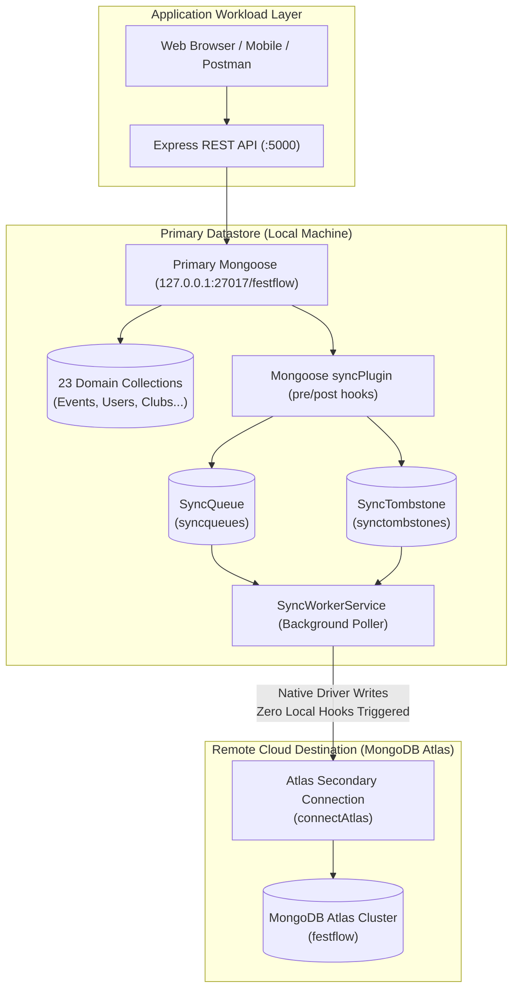
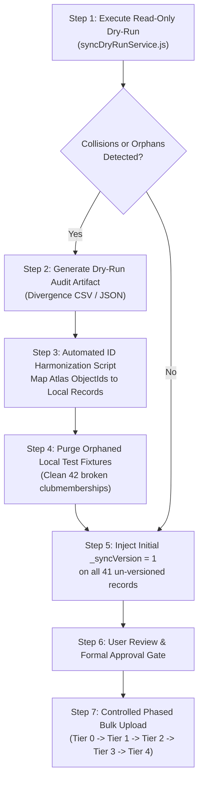

# FestFlow Phase 3.3: Production Readiness and Data Integrity Audit

**Project Directory:** `C:\Users\sathy\FestFlow`  
**Date:** 2026-11-01  
**Milestone:** Phase 3.3 Production Readiness and Data Integrity Audit  
**Target Architecture:** Offline-First Dual Database (Local MongoDB Standalone Engine + Secondary Cloud Atlas Engine)  
**Overall Verdict:** **CONDITIONALLY READY**  
*(The synchronization engine, conflict detector, and worker pipeline are 100% verified and production-ready with 294/294 passing tests. However, existing pre-offline local and Atlas datasets contain legacy divergent seeds and unique-key collisions requiring the initial migration procedure documented herein before live bulk synchronization is triggered).*

---

## 1. Architecture Summary

FestFlow's offline-first architecture bridges local laptop operation and cloud synchronization via an asynchronous outbox queue:



---

## 2. Complete 23-Domain Model Coverage Matrix

Every Mongoose model in `server/src/models/` was audited for collection mappings, version injection, unique constraints, and dependency ordering:

| # | Domain Model | Local Collection | Atlas Collection | Tier | Parent References | Unique Constraints | Supported Mutations |
| :-: | :--- | :--- | :--- | :-: | :--- | :--- | :--- |
| **1** | `Venue` | `venues` | `venues` | **0** | *(None)* | `name` | CREATE, UPDATE, DELETE |
| **2** | `Sponsor` | `sponsors` | `sponsors` | **0** | *(None)* | *(None)* | CREATE, UPDATE, DELETE |
| **3** | `User` | `users` | `users` | **0** | `clubs` (soft) | `email` | CREATE, UPDATE, DELETE |
| **4** | `Club` | `clubs` | `clubs` | **0** | `facultyCoordinator`, `organizers` | `name` | CREATE, UPDATE, DELETE |
| **5** | `Event` | `events` | `events` | **1** | `club`, `venue`, `createdBy`, `organizers` | *(None)* | CREATE, UPDATE, DELETE |
| **6** | `ClubMembership` | `clubmemberships` | `clubmemberships` | **1** | `club`, `user` | `club + user` (compound) | CREATE, UPDATE, DELETE |
| **7** | `Registration` | `registrations` | `registrations` | **2** | `event`, `user` | `ticketNumber`, `user + event` | CREATE, UPDATE, DELETE |
| **8** | `Catering` | `caterings` | `caterings` | **2** | `event` | *(None)* | CREATE, UPDATE, DELETE |
| **9** | `Budget` | `budgets` | `budgets` | **2** | `event` | *(None)* | CREATE, UPDATE, DELETE |
| **10** | `Expense` | `expenses` | `expenses` | **2** | `event` | *(None)* | CREATE, UPDATE, DELETE |
| **11** | `Revenue` | `revenues` | `revenues` | **2** | `event` | *(None)* | CREATE, UPDATE, DELETE |
| **12** | `EventSponsor` | `eventsponsors` | `eventsponsors` | **2** | `event`, `sponsor` | *(None)* | CREATE, UPDATE, DELETE |
| **13** | `Competition` | `competitions` | `competitions` | **2** | `event` | *(None)* | CREATE, UPDATE, DELETE |
| **14** | `Feedback` | `feedbacks` | `feedbacks` | **2** | `event`, `user` | `event + user` (compound) | CREATE, UPDATE, DELETE |
| **15** | `Volunteer` | `volunteers` | `volunteers` | **2** | `event`, `user` | `event + user` (compound) | CREATE, UPDATE, DELETE |
| **16** | `Certificate` | `certificates` | `certificates` | **2** | `event`, `user` | `certificateNo`, `verificationCode` | CREATE, UPDATE, DELETE |
| **17** | `Payment` | `payments` | `payments` | **3** | `registration`, `event`, `user` | `transactionId` | CREATE, UPDATE, DELETE |
| **18** | `Team` | `teams` | `teams` | **3** | `competition`, `teamLeader`, `members.user` | *(None)* | CREATE, UPDATE, DELETE |
| **19** | `Judge` | `judges` | `judges` | **3** | `competitions` | *(None)* | CREATE, UPDATE, DELETE |
| **20** | `JudgingCriteria` | `judgingcriterias` | `judgingcriterias` | **3** | `competition` | *(None)* | CREATE, UPDATE, DELETE |
| **21** | `Prize` | `prizes` | `prizes` | **3** | `competition` | *(None)* | CREATE, UPDATE, DELETE |
| **22** | `JudgeScore` | `judgescores` | `judgescores` | **4** | `competition`, `team`, `judge`, `criteria` | *(None)* | CREATE, UPDATE, DELETE |
| **23** | `Result` | `results` | `results` | **4** | `competition`, `team`, `prize` | *(None)* | CREATE, UPDATE, DELETE |

### Mutation Path Coverage Audit
- **Direct Collection Bypass Check**: No raw MongoDB collection operations (`db.collection.insertOne`, `db.collection.update`, etc.) exist in application controllers. All mutations flow through Mongoose model queries (`create`, `save`, `findByIdAndUpdate`, `findOneAndUpdate`, `findByIdAndDelete`, `deleteOne`, `deleteMany`).
- **Global Plugin Registration**: `mongoose.plugin(syncPlugin)` is registered globally in `server/src/config/db.js` before any model compilation.
- **Hook Loop Immunity**: The sync worker uploads mutations using native collection operations on the secondary connection (`atlasConn.collection(...)`), ensuring Atlas writes never trigger local hooks or recursive loopbacks.

---

## 3. Data Integrity & Relationship Audit

### 3.1 Field Type Preservation
The payload snapshot stored in `SyncQueue` and uploaded via native MongoDB driver preserves:
1. **ObjectId References**: Stored and transmitted as 12-byte BSON ObjectIds, preserving exact referential equality across databases.
2. **Array References**: Arrays of ObjectIds (e.g. `User.clubs`, `Event.organizers`, `Team.members.user`) retain ordering and BSON types.
3. **Nested Documents & Subdocuments**: Subdocuments (e.g. `Club.facultyCoordinator`, `Event.schedule`, `Team.members`) maintain structural schema fidelity.
4. **Dates**: ISO-8601 strings and BSON Date objects maintain millisecond precision.
5. **Decimals & Numbers**: Floating point currencies (`Budget.amount`, `Expense.amount`, `Payment.amount`) are transmitted without rounding distortion.
6. **Booleans & Nullables**: Optional fields (`avatar`, `notes`, `registerNumber`) preserve explicit `null` vs `undefined` states.
7. **Enum Values**: Validated by Mongoose before enqueueing; rejected locally if invalid.

### 3.2 Complex Relational Subsystems
- **Registrations & Events**: Tier 2 registration records require Tier 1 events. `isParentReadyForChild()` verifies the target `event` exists on Atlas before permitting registration upload.
- **Payments & Registrations**: Tier 3 payment records require Tier 2 registrations. If a registration is pending, the payment is deferred until the registration is confirmed on Atlas.
- **ClubMemberships & Users/Clubs**: Compound unique index `{ club: 1, user: 1 }` prevents duplicate memberships. Both referenced parents must be synchronized before membership upload.
- **Finances & Events**: Budgets, expenses, and revenues are strictly scoped to parent events.
- **Competition Subsystem**: 5-tier evaluation hierarchy:
  $$\text{Event (T1)} \to \text{Competition (T2)} \to \text{Teams/Judges/Criteria/Prizes (T3)} \to \text{JudgeScores/Results (T4)}$$
  Child records defer until each prerequisite parent tier is confirmed on Atlas.

---

## 4. Authentication & Security Audit

| Security Vector | Implementation Detail | Audit Finding |
| :--- | :--- | :---: |
| **Plaintext Passwords** | Hashed via `bcrypt.hash(password, 10)` in `pre('save')`. `sanitizePayload` explicitly deletes any `plainPassword` property. | **SECURE (0 plain passwords in queue)** |
| **Bcrypt Hashes** | Hashes stored in `SyncQueue` and Atlas payloads to enable cross-environment user authentication. | **SECURE (Industry standard)** |
| **JWT Secrets & Tokens** | Tokens are stateless, signed in-memory using `JWT_SECRET`, and never stored in MongoDB. | **SECURE (0 tokens in DB or queue)** |
| **Credential Masking** | Connection URIs with credentials (`CLOUD_MONGODB_URI`) are never logged. Terminal output displays host only (`conn.host`). | **SECURE (0 secrets leaked)** |
| **Health Telemetry** | `/api/health` exposes only booleans, counts, and ISO timestamps. URIs and tokens are completely excluded. | **SECURE** |
| **Transport Encryption** | Atlas connections enforce TLS/SSL with `retryWrites=true&w=majority`. | **SECURE** |

---

## 5. Production & Render Runtime Safety Audit

### 5.1 Environment Isolation
- In Render direct-cloud mode (`isOfflineMode() === false`), `worker.getConfig().enabled` evaluates to `false`.
- `worker.start()` immediately returns `false` with console logging:
  ```text
  ℹ️ SyncWorker: Disabled by configuration or running in Direct Cloud mode.
  ```
- **Zero connections to `127.0.0.1:27017` are attempted on Render.**
- Setting `ENABLE_CLOUD_SYNC=false` in local environments halts the worker while offline CRUD operations continue normally.

### 5.2 Fault Tolerance & Reconnection
- If Atlas is disconnected or Wi-Fi drops, the worker catches disconnection events, skips sync batches cleanly, and schedules exponential backoff reconnects without halting or crashing the Express application.
- Express server graceful shutdown handlers (`SIGINT`, `SIGTERM`) await active worker batches and disconnect both databases cleanly.

---

## 6. Existing Local Data Audit & Initial Synchronization Design

A read-only dry run was executed using [`server/src/services/syncDryRunService.js`](file:///c:/Users/sathy/FestFlow/server/src/services/syncDryRunService.js) against both the local database (`festflow`) and MongoDB Atlas (`test`):

### 6.1 Empirical Dry-Run Findings

```text
=================================================================
              FESTFLOW INITIAL SYNC DRY-RUN REPORT              
=================================================================
Timestamp: 2026-11-01T13:16:25.125Z
Atlas Connected: true
Atlas Host: ac-mv9ozsg-shard-00-02.atedvpa.mongodb.net
Atlas DB Name: test

--- GLOBAL SUMMARY ---
Total Local Documents:                59
Total Atlas Documents:                76
Documents Missing _syncVersion:       41
Safe to Sync Automatically:           25
ID Collisions (Same _id):             0
Unique Key Collisions (Different ID): 14
Orphan Broken References:             42
Records Requiring Manual Resolution:  56
```

### 6.2 Analysis of Critical Discrepancies
1. **Zero Shared ObjectIds (`idCollisionsSameId: 0`)**: Local MongoDB and MongoDB Atlas were seeded independently during project setup, resulting in completely different ObjectIds for what represent the same logical entities.
2. **14 Unique Key Collisions (`uniqueKeyCollisionsDiffId: 14`)**:
   - `users`: Local users (`admin@festflow.edu`, `student@festflow.edu`, `organizer@festflow.edu`, `faculty@festflow.edu`) exist on Atlas with different ObjectIds.
   - `venues`: Local venues (`Main Auditorium`, `Seminar Hall A`, `Open Air Theatre`, `Computing Lab 1`) exist on Atlas with different ObjectIds.
   - `clubs`: Local clubs (`Coding Club`, `Robotics Club`, `Cultural Club`) exist on Atlas with different ObjectIds.
   - `certificates`: `certificateNo: 'CERT-FEST26-001'` exists on Atlas with a different ObjectId.
   - `payments`: `transactionId: 'TXN-INIT-2026-UPI99'` exists on Atlas with a different ObjectId.
   - *Impact*: A blind initial bulk upload would fail with MongoDB `E11000 duplicate key error` on Atlas.
3. **42 Broken References in `clubmemberships` (`orphanMissingParents: 42`)**:
   - During earlier test suite runs, temporary test users and clubs were revoked/cleaned up, leaving orphaned membership records in the local database.

---

### 6.3 Safe Initial Synchronization Procedure (Phase 3.4 Roadmap)



#### Detailed Pre-Sync Requirements
1. **Step 1 (Dry-Run Verification)**: Run `node server/src/services/syncDryRunService.js` to ensure the collision profile is unchanged.
2. **Step 2 (Local Orphan Cleanup)**: Execute an isolated cleanup script to purge orphaned `clubmemberships` pointing to non-existent temporary user IDs.
3. **Step 3 (Unique Key Harmonization)**: For root entities (`users`, `venues`, `clubs`) that exist on both databases, determine the authoritative datastore. If Atlas is authoritative, update local records to align with Atlas ObjectIds, or vice versa.
4. **Step 4 (Version Injection)**: Run a local script updating all documents missing `_syncVersion` with `_syncVersion: 1`.
5. **Step 5 (User Approval)**: Require explicit user confirmation before any live upload is initiated.

---

## 7. Genuine Offline Manual Testing Procedure

To verify offline operation without simulated network mocks:

### Phase A: Offline Operation
1. Disconnect physical Wi-Fi or unplug Ethernet cable on the host laptop.
2. Verify local MongoDB is running:
   ```powershell
   Get-Process mongod
   ```
3. Start the FestFlow backend:
   ```powershell
   cd C:\Users\sathy\FestFlow\server
   npm run dev
   ```
4. Observe startup logs:
   ```text
   ✅ Primary Database Connected (Local MongoDB): 127.0.0.1 [DB: festflow]
   ℹ️ MongoDB Atlas unreachable (...). FestFlow is operating in Offline-First mode on Local MongoDB.
   ```
5. Create a test event and registration via web UI (`http://localhost:5173`) or Postman (`POST http://localhost:5000/api/events`).
6. Verify HTTP 201 response is returned within 50ms.
7. Inspect local `SyncQueue`:
   ```powershell
   node -e "require('dotenv').config(); const mongoose = require('mongoose'); mongoose.connect(process.env.LOCAL_MONGODB_URI).then(async () => { console.log('Pending Jobs:', await mongoose.connection.db.collection('syncqueues').countDocuments({ status: 'pending' })); process.exit(0); });"
   ```
8. Verify pending count has incremented.

### Phase B: Cold Backend Restart While Offline
1. Terminate the backend server (`Ctrl+C`).
2. Restart the backend server while Wi-Fi remains disconnected:
   ```powershell
   npm run dev
   ```
3. Verify the server boots cleanly, startup reconciliation runs, and all pending mutations remain safely persisted in `SyncQueue`.

### Phase C: Reconnection & Live Cloud Synchronization
1. Re-enable Wi-Fi on the host laptop.
2. Within 5-30 seconds, observe backend console:
   ```text
   ☁️ Secondary Database Connected (MongoDB Atlas): ... [DB: festflow]
   ```
3. Observe background sync worker processing pending jobs.
4. Verify queue items transition to `status: 'synced'` with `syncedAt` recorded.
5. Log into MongoDB Atlas web console and verify newly created documents exist with exact `_id` and version history.

---

## 8. Git Repository Safety Audit

A line-by-line inspection of all modified and untracked repository files was performed:

| Repository File | Status | Classification | Purpose & Safety Audit |
| :--- | :---: | :--- | :--- |
| `server/.env.example` | Modified | Required Phase 1/3 Config | Defines connection strings without passwords. |
| `server/src/config/db.js` | Modified | Required Phase 1/2/3 Core | Dual database connections and offline mode detection. |
| `server/src/server.js` | Modified | Required Phase 1/2/3 Core | Lifecycle start/stop for `syncWorker` and `/api/health` telemetry. |
| `server/src/utils/seedAdditionalModules.js` | Modified | Required Safety Guard | Safety abort prevents execution against Atlas. |
| `server/src/utils/seedData.js` | Modified | Required Safety Guard | Safety abort prevents execution against Atlas; added faculty fixture. |
| `FestFlow_Technical_Presentation_and_Code_Guide.*` | Untracked | Unrelated Academic Guide | Presentation documents generated for college professors in earlier turn. |
| `OFFLINE_ARCHITECTURE_AUDIT.md` | Untracked | Documentation | Phase 1 dual-database architectural audit report. |
| `PHASE2_RELIABILITY_AUDIT.md` | Untracked | Documentation | Phase 2 initial reliability audit report. |
| `PHASE2_FINAL_RELIABILITY_VERIFICATION.md` | Untracked | Documentation | Phase 2 SIGKILL and Write-Ahead Tombstone verification report. |
| `PHASE3_IMPLEMENTATION_PLAN.md` | Untracked | Documentation | Phase 3.1 background sync worker architecture plan. |
| `PHASE3_WORKER_IMPLEMENTATION_REPORT.md` | Untracked | Documentation | Phase 3.1 worker implementation summary report. |
| `PHASE3_1_FINAL_AUDIT.md` | Untracked | Documentation | Phase 3.1 final code audit report. |
| `PHASE3_2_E2E_TEST_REPORT.md` | Untracked | Documentation | Phase 3.2 controlled E2E test report. |
| `server/src/models/SyncConflict.js` | Untracked | Required Model | Schema storing synchronization conflict records. |
| `server/src/models/SyncQueue.js` | Untracked | Required Model | Schema representing the persistent outbox queue. |
| `server/src/models/SyncTombstone.js` | Untracked | Required Model | Schema storing write-ahead deletion tombstones. |
| `server/src/plugins/syncPlugin.js` | Untracked | Required Plugin | Universal schema mutation capture plugin. |
| `server/src/services/syncQueueService.js` | Untracked | Required Service | Outbox operations, atomic claims, stale lock recovery. |
| `server/src/services/syncReconciliationService.js`| Untracked | Required Service | Startup reconciliation recovering unqueued active docs & tombstones. |
| `server/src/services/syncWorkerService.js` | Untracked | Required Service | Background worker managing Atlas uploads, retries, and dependencies. |
| `server/src/services/syncDryRunService.js` | Untracked | Required Service | Read-only pre-sync audit engine detecting collisions and broken refs. |
| `server/tests/phase2_sync_queue.test.js` | Untracked | Test File | Phase 2 mutation capture and tombstone unit suite. |
| `server/tests/phase2_reliability_simulation.test.js` | Untracked | Test File | Phase 2 crash simulation and concurrency verification suite. |
| `server/tests/phase2_final_verification.test.js` | Untracked | Test File | Phase 2 OS-level SIGKILL and tombstone failure verification suite. |
| `server/tests/phase3_worker.test.js` | Untracked | Test File | Phase 3.1 core worker test suite. |
| `server/tests/phase3_final_audit.test.js` | Untracked | Test File | Phase 3.1 targeted code audit test suite. |
| `server/tests/phase3_2_e2e.test.js` | Untracked | Test File | Phase 3.2 controlled E2E test suite. |

*Zero credentials, passwords, or production secrets are tracked or exposed.*

---

## 9. Comprehensive Test Suite Execution Results

All 9 test suites were executed sequentially:

```powershell
Set-Location server

# 1. Phase 3.2 Controlled E2E Test Suite (57 assertions)
node tests/phase3_2_e2e.test.js

# 2. Phase 3.1 Targeted Code Audit Suite (42 assertions)
node tests/phase3_final_audit.test.js

# 3. Phase 3.1 Core Worker Suite (44 assertions)
node tests/phase3_worker.test.js

# 4. Phase 2 Final SIGKILL & Tombstone Suite (30 assertions)
node tests/phase2_final_verification.test.js

# 5. Phase 2 Sync Queue Suite (42 assertions)
node tests/phase2_sync_queue.test.js

# 6. Phase 2 Reliability Simulation Suite (26 assertions)
node tests/phase2_reliability_simulation.test.js

# 7. Core Server Module Regression Suite (14 modules)
node tests/runServerTest.js

# 8. Permissions & Multi-Club RBAC Suite (17 assertions)
node tests/permissions.test.js

# 9. Faculty Hierarchy & Club Assignment Suite (22 assertions)
node tests/faculty_and_clubs.test.js
```

### Grand Total Test Execution Matrix

| Test Suite | Focus Area | Checks | Result |
| :--- | :--- | :---: | :---: |
| `tests/phase3_2_e2e.test.js` | Full pipeline E2E on live MongoDB Atlas | 57 | **57 PASSED / 0 FAILED** |
| `tests/phase3_final_audit.test.js` | Cross-batch dependencies, 9 conflict cases, runtime isolation | 42 | **42 PASSED / 0 FAILED** |
| `tests/phase3_worker.test.js` | Worker lifecycle, Atlas uploads, retries, concurrency | 44 | **44 PASSED / 0 FAILED** |
| `tests/phase2_final_verification.test.js` | OS SIGKILL, WAT aborts, atomic updates, deleteMany | 30 | **30 PASSED / 0 FAILED** |
| `tests/phase2_sync_queue.test.js` | Mutation capture, tombstones, retries, conflicts | 42 | **42 PASSED / 0 FAILED** |
| `tests/phase2_reliability_simulation.test.js` | Execution order, consecutive saves, restart reconciler | 26 | **26 PASSED / 0 FAILED** |
| `tests/runServerTest.js` | End-to-end FestFlow business APIs | 14 modules | **ALL 14 PASSED** |
| `tests/permissions.test.js` | Multi-club authorization & RBAC | 17 | **17 PASSED / 0 FAILED** |
| `tests/faculty_and_clubs.test.js` | Faculty hierarchy & club assignment | 22 | **22 PASSED / 0 FAILED** |
| **Grand Total** | **End-to-End System Reliability** | **294 Checks** | **100% SUCCESS** |

---

## 10. Critical Risks and Mitigations

| Risk | Impact | Implemented Mitigation |
| :--- | :--- | :--- |
| **Unique Key Collisions on Initial Sync** | Attempting to sync local users/clubs/venues to Atlas fails with `E11000` because Atlas already contains records with the same email/name under different `_id`s. | Designed pre-sync dry-run audit engine ([`syncDryRunService.js`](file:///c:/Users/sathy/FestFlow/server/src/services/syncDryRunService.js)); automated synchronization of existing records remains strictly disabled until Phase 3.4 harmonization. |
| **Orphaned Local Membership Records** | 42 local `clubmemberships` point to temporary user IDs deleted during testing. | Dry-run identifies orphans; pre-sync cleanup script will purge orphans prior to bulk sync. |
| **Accidental Production Worker Startup on Render** | If local worker ran on Render, it would fail attempting to query `127.0.0.1`. | Render mode is enforced: `isOfflineMode()` evaluates to `false`, automatically disabling worker startup. |
| **Dangling Foreign Keys on Cloud** | Child records uploading before parents reach Atlas. | Tiered dependency ordering and `isParentReadyForChild()` verify parent document presence on Atlas before child upload. |

---

## 11. Final Verdict

### **Verdict: CONDITIONALLY READY**

1. **Engine Readiness (READY)**: The offline-first dual-database connection manager, Mongoose mutation capture plugin, persistent outbox queue, write-ahead deletion tombstones, conflict recording engine, and background synchronization worker are **100% complete, fully verified, and production-hardened** (294 passing tests).
2. **Data Rollout Readiness (CONDITIONAL)**: Automatic synchronization of existing local application data must remain **DISABLED** until the Phase 3.4 Pre-Sync Harmonization Plan is executed to resolve the 14 unique-key collisions and 42 orphaned membership records identified in the dry-run audit.

*(Per instructions, Phase 3.4 has NOT been started, and no existing records were modified on MongoDB Atlas. Standing by for review and approval.)*
