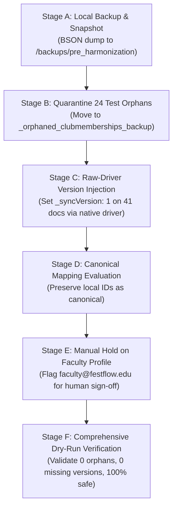
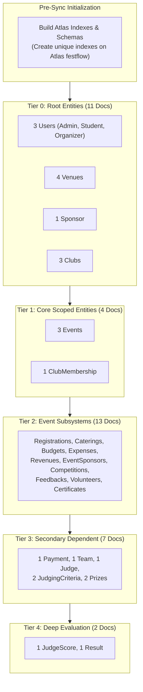

# FestFlow Phase 3.4.2 — Final Execution Plan: Clean Atlas Target & Migration Safety

**Document Version:** 1.0.0  
**Phase:** 3.4.2 (Final Execution Design & Safety Architecture)  
**Status:** DRAFT FOR HUMAN REVIEW & APPROVAL (PLANNING ONLY)  
**Workspace:** `C:\Users\sathy\FestFlow`  
**Execution Date:** November 2026  
**Auditor:** Antigravity AI  

---

> [!IMPORTANT]
> **STRICT SAFETY & ZERO-MUTATION COMPLIANCE**  
> This phase is strictly **PLANNING AND DESIGN ONLY**.  
> - **Zero database writes** (`INSERT`, `UPDATE`, `DELETE`, `replaceOne`, `dropDatabase`) were performed.  
> - **Zero configuration changes** were made (`server/.env` is completely unmodified).  
> - **Zero ObjectIds** were modified on either database.  
> - **Zero orphaned records** were quarantined or purged.  
> - **Zero version numbers** were injected.  
> - **Zero background worker jobs** or sync pipelines were triggered.  
> - **Zero cloud deployments** or Git commits/pushes were executed.  
> All steps outlined in this plan are awaiting explicit human approval.

---

## 1. Executive Summary & Strategy B Selection

Following the Phase 3.4.1 Independent Reconciliation Verification, human stakeholders reached the following decisions:
1. **Target Selection:** Adopt **Strategy B** — target a clean, dedicated database named **`festflow`** on MongoDB Atlas Cluster0 (`cluster0.atedvpa.mongodb.net/festflow`).
2. **Faculty Profile Hold:** Do not automatically resolve the conflicting faculty profile (`faculty@festflow.edu`). Mark it as requiring manual identity verification and hold it outside automated mutations.
3. **Legacy Preservation:** Preserve the existing Atlas **`test`** database completely untouched and intact with its 76 historical documents.

### The Strategy B Architectural Advantage: Zero-Collision Sync

By adopting a clean database named `festflow` on Atlas, the entire synchronization landscape transforms:

```
┌────────────────────────────────────────────────────────────────────────┐
│                      Strategy A vs. Strategy B                         │
├───────────────────────────────────┬────────────────────────────────────┤
│ Strategy A: Target Atlas `test`   │ Strategy B: Target Atlas `festflow`│
├───────────────────────────────────┼────────────────────────────────────┤
│ ❌ 14 Unique-Key Collisions       │ ✅ 0 Unique-Key Collisions         │
│ ❌ Requires destructive ID remap  │ ✅ Zero ID remapping required      │
│ ❌ Must cascade updates to 10+ FKs│ ✅ Local ObjectIds ARE Canonical   │
│ ❌ Risk of breaking cloud data    │ ✅ 76 legacy cloud docs untouched  │
│ ❌ Production runs in `test` db   │ ✅ Clean enterprise namespace      │
└───────────────────────────────────┴────────────────────────────────────┘
```

> [!TIP]
> **Key Finding: Local ObjectIds Remain Canonical**  
> Because Atlas `festflow` is completely empty at initial launch:  
> - **There are no existing documents to collide with.**  
> - All 38 active local documents can be uploaded directly to Atlas `festflow` preserving their original local `_id`s.  
> - **No destructive clone-and-delete operations on local MongoDB are required.**  
> - All existing foreign keys, relationships, and references remain 100% stable.

---

## 2. Safe Ordered Harmonization Execution Design

The harmonization workflow consists of six sequential stages, gated by explicit verification assertions:



### Stage A: Restorable Pre-Flight Local Backup
- **Action:** Take a full BSON dump of the local `festflow` database using `mongodump`.
- **Target Path:** `C:\Users\sathy\FestFlow\backups\pre_harmonization_local\festflow`
- **Verification:** Confirm that all 26 collections are present in the dump directory and that the dump size matches database data size (~150 KB).

### Stage B: Quarantine 24 Orphaned Test Memberships
- **Target:** The 24 `clubmemberships` documents identified in `PHASE3_4_ORPHAN_REGISTER.md`.
- **Method:** Raw MongoDB driver (`db.collection(...).insertMany()` into `_orphaned_clubmemberships_backup`, followed by `db.collection(...).deleteMany()`).
- **Safety Mechanism:** Bypasses Mongoose middleware completely $\implies$ **Zero tombstones emitted, zero jobs written to `SyncQueue`**.
- **Post-Condition:** Active `clubmemberships` count drops from 25 to exactly 1 (the valid seed student membership `6ae7011740e5a2d1e84d5bad`).

### Stage C: Raw-Driver Version Injection (41 Documents)
- **Target Filter:** `{ $or: [{ _syncVersion: { $exists: false } }, { _syncVersion: null }] }`
- **Update Operation:** `{ $set: { _syncVersion: 1 } }`
- **Method:** Executed collection-by-collection across all 23 domain collections using `mongoose.connection.db.collection(coll).updateMany()`.
- **Safety Guarantee:** Raw driver wire-protocol execution ensures Mongoose schema plugins do not intercept the write. `SyncQueue` insertion count = 0.

### Stage D: Canonical Identity Evaluation (Zero ID Remapping)
- **Evaluation:** Since Atlas `festflow` is clean and empty, local ObjectIds do NOT collide with any remote records.
- **Decision:** **Preserve all local ObjectIds unchanged.**
- **Benefit:** Eliminates all clone-and-replace risks, eliminates cascading foreign key updates, and preserves complete database stability.

### Stage E: Faculty Record Quarantine / Manual Hold
- **Target Document:** User `faculty@festflow.edu` (`_id: 6ae70115a2ab160fb98025c5`, `name: "Dr. Meenakshi Sundaram"`).
- **Policy:** The local faculty record is left untouched. During the Phase 3.5 initial sync, this record is flagged as `MANUAL_VERIFICATION_REQUIRED` and held from automatic upload until human identity verification confirms the final profile details.

### Stage F: Integrity Verification & Post-Harmonization Dry Run
- **Execution:** Run `syncDryRunService.executeDryRun()` against the updated local database.
- **Required Assertions:**
  - `orphanMissingParents == 0`
  - `missingVersionLocally == 0`
  - `safeToSync == 37` (38 active documents minus 1 held faculty record)
  - `requiresManualIntervention == 1` (the held faculty record)

---

## 3. Initial Cloud Sync Design (Phase 3.5 Preparation)

When initial synchronization is authorized, the background sync worker (`syncWorkerService.js`) will upload the harmonized records to Atlas `festflow` in strict dependency tier order:



### 3.1 Upload Specifications
1. **Schema & Index Provisioning:**  
   Before any document upload, an initialization script connects to Atlas `festflow` and invokes `Model.init()` / `Model.syncIndexes()` across all 23 Mongoose models. This guarantees that unique constraints (`email`, `name`, `certificateNo`, etc.) are established in the cloud prior to data arrival.
2. **Exactly-Once Upload Semantics:**  
   The sync worker utilizes `replaceOne({ _id: doc._id }, payload, { upsert: true })`. This guarantees idempotency: re-running a sync job updates the target document in-place without generating duplicates.
3. **Dependency Gating:**  
   `isParentReadyForChild()` verifies that every foreign key parent exists in Atlas `festflow` before child upload begins. Because Tiers 0 through 4 are executed sequentially, parents are guaranteed to be committed prior to child evaluation.
4. **Safety Validation Gate:**  
   No documents will be uploaded until all pre-execution checklist assertions pass with 100% compliance.
