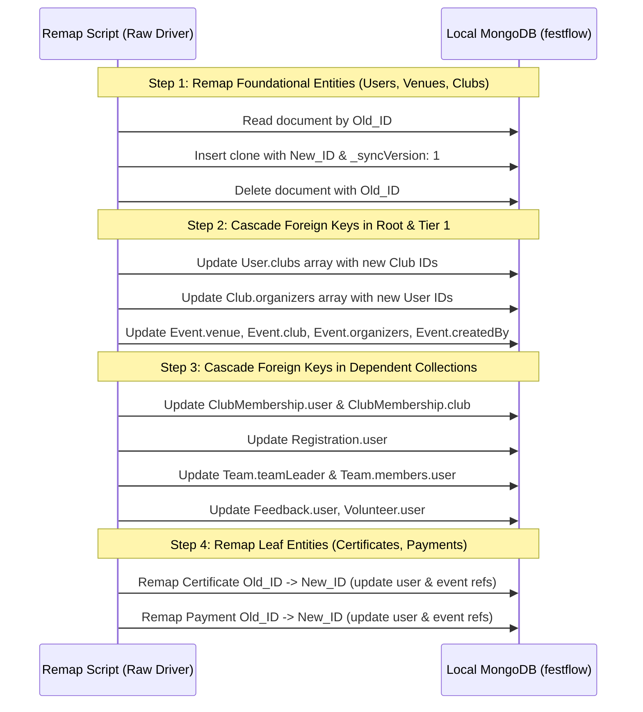

# FestFlow Phase 3.4 — ObjectId Remapping & Reference Cascade Plan

**Document Version:** 1.0.0  
**Status:** DRAFT FOR HUMAN REVIEW & APPROVAL  
**Workspace:** `C:\Users\sathy\FestFlow`  
**Execution Date:** November 2026  

---

## 1. Executive Summary & Philosophy

When local entities share natural unique keys with existing Atlas entities (e.g. `student@festflow.edu`, `CodeNexus Developers Club`, `Open Air Amphitheatre`), maintaining separate ObjectIds creates an insurmountable collision during synchronization.

Because MongoDB BSON `_id` fields are immutable on existing documents, "updating an `_id`" requires an atomic two-step procedure via the native database driver:
1. Clone the existing local document under the canonical Atlas `_id`.
2. Delete the obsolete document with the local `_id`.
3. Cascade the new canonical `_id` to all local inbound foreign key references across all referencing collections.

> [!IMPORTANT]
> **Zero Outbox Queue Trigger Guarantee**  
> All remapping and cascade operations will be executed using the raw `mongodb` native driver (`db.collection(...).bulkWrite()` and `db.collection(...).updateOne()`), completely bypassing Mongoose schema middleware.  
> This guarantees that **no spurious CREATE or DELETE mutation jobs are recorded in `SyncQueue`** during the remapping process.

---

## 2. Master ObjectId Remapping Dictionary

Below is the complete, definitive Old-ID $\to$ New-ID mapping dictionary for all 13 colliding documents:

```javascript
const OBJECTID_REMAP_DICTIONARY = {
  // 1. Users (Tier 0)
  "6ae70115a2ab160fb98025bf": "6ad4a6116da4de724485d374", // admin@festflow.edu
  "6ae70115a2ab160fb98025c1": "6ad4a6116da4de724485d376", // organizer@festflow.edu
  "6ae70115a2ab160fb98025c3": "6ad4a6116da4de724485d378", // student@festflow.edu
  "6ae70115a2ab160fb98025c5": "6ada6791bee088392214dfee", // faculty@festflow.edu

  // 2. Venues (Tier 0)
  "6ae70116a2ab160fb98025c7": "6ad4a6116da4de724485d37a", // Dr. APJ Abdul Kalam Auditorium
  "6ae70116a2ab160fb98025d0": "6ad4a6116da4de724485d383", // Open Air Amphitheatre
  "6ae70116a2ab160fb98025cc": "6ad4a6116da4de724485d37f", // Alan Turing Advanced Computing Lab
  "6ae70116a2ab160fb98025d4": "6ad4a6116da4de724485d387", // Aryabhata Seminar Hall

  // 3. Clubs (Tier 0)
  "6ae70116a2ab160fb98025db": "6ad4a6126da4de724485d38e", // CodeNexus Developers Club
  "6ae70116a2ab160fb98025dc": "6ad4a6126da4de724485d38f", // Dhwani Cultural & Music Society
  "6ae70116a2ab160fb98025dd": "6ad4a6126da4de724485d390", // RoboTech Innovation Club

  // 4. Certificates (Tier 2 / Collisions #1 & #2)
  "6ae7011740e5a2d1e84d5bb3": "6ad4ac57c652f091549f64fa", // CERT-2026-FEST-001

  // 5. Payments (Tier 3 / Collision #6)
  "6ae7011740e5a2d1e84d5bb0": "6ad4ac57c652f091549f64f7"  // TXN-INIT-2026-UPI99
};
```

---

## 3. Inbound Reference Cascade Matrix

When an `_id` is remapped, every local collection that holds a foreign key reference to that entity must be updated.

### 3.1 User Remapping Cascade

| Colliding User | Local Old `_id` | Canonical Atlas `_id` | Target Local Collection | Foreign Key Field | Field Type | Update Operation |
| :--- | :--- | :--- | :--- | :--- | :--- | :--- |
| **`organizer@festflow.edu`** | `6ae70115a2ab160fb98025c1` | `6ad4a6116da4de724485d376` | `clubs` | `organizers` | Array of ObjectIds | `$set: { "organizers.$[elem]": newId }` |
| | | | `events` | `organizers` | Array of ObjectIds | `$set: { "organizers.$[elem]": newId }` |
| | | | `events` | `createdBy` | Single ObjectId | `$set: { createdBy: newId }` |
| | | | `teams` | `members.user` | Nested Array Doc | `$set: { "members.$[elem].user": newId }` |
| **`student@festflow.edu`** | `6ae70115a2ab160fb98025c3` | `6ad4a6116da4de724485d378` | `clubmemberships`| `user` | Single ObjectId | `$set: { user: newId }` |
| | | | `registrations` | `user` | Single ObjectId | `$set: { user: newId }` |
| | | | `payments` | `user` | Single ObjectId | `$set: { user: newId }` |
| | | | `feedbacks` | `user` | Single ObjectId | `$set: { user: newId }` |
| | | | `volunteers` | `user` | Single ObjectId | `$set: { user: newId }` |
| | | | `certificates` | `user` | Single ObjectId | `$set: { user: newId }` |
| | | | `teams` | `teamLeader` | Single ObjectId | `$set: { teamLeader: newId }` |
| | | | `teams` | `members.user` | Nested Array Doc | `$set: { "members.$[elem].user": newId }` |
| **`faculty@festflow.edu`** | `6ae70115a2ab160fb98025c5` | `6ada6791bee088392214dfee` | `clubs` | `facultyCoordinator.user` | Subdoc ObjectId | `$set: { "facultyCoordinator.user": newId }` |
| **`admin@festflow.edu`** | `6ae70115a2ab160fb98025bf` | `6ad4a6116da4de724485d374` | (None local) | N/A | N/A | No local inbound refs |

### 3.2 Club Remapping Cascade

| Colliding Club | Local Old `_id` | Canonical Atlas `_id` | Target Local Collection | Foreign Key Field | Field Type | Update Operation |
| :--- | :--- | :--- | :--- | :--- | :--- | :--- |
| **CodeNexus** | `6ae70116a2ab160fb98025db` | `6ad4a6126da4de724485d38e` | `events` | `club` | Single ObjectId | `$set: { club: newId }` |
| | | | `clubmemberships`| `club` | Single ObjectId | `$set: { club: newId }` |
| | | | `users` | `clubs` | Array of ObjectIds | `$set: { "clubs.$[elem]": newId }` |
| **Dhwani** | `6ae70116a2ab160fb98025dc` | `6ad4a6126da4de724485d38f` | `events` | `club` | Single ObjectId | `$set: { club: newId }` |
| | | | `users` | `clubs` | Array of ObjectIds | `$set: { "clubs.$[elem]": newId }` |
| **RoboTech** | `6ae70116a2ab160fb98025dd` | `6ad4a6126da4de724485d390` | `users` | `clubs` | Array of ObjectIds | `$set: { "clubs.$[elem]": newId }` |

### 3.3 Venue Remapping Cascade

| Colliding Venue | Local Old `_id` | Canonical Atlas `_id` | Target Local Collection | Foreign Key Field | Field Type | Update Operation |
| :--- | :--- | :--- | :--- | :--- | :--- | :--- |
| **Kalam Auditorium** | `6ae70116a2ab160fb98025c7` | `6ad4a6116da4de724485d37a` | (None local) | N/A | N/A | No local inbound refs |
| **Open Air Amphitheatre**| `6ae70116a2ab160fb98025d0` | `6ad4a6116da4de724485d383` | `events` | `venue` | Single ObjectId | `$set: { venue: newId }` |
| **Turing Computing Lab** | `6ae70116a2ab160fb98025cc` | `6ad4a6116da4de724485d37f` | `events` | `venue` | Single ObjectId | `$set: { venue: newId }` |
| **Aryabhata Hall** | `6ae70116a2ab160fb98025d4` | `6ad4a6116da4de724485d387` | `events` | `venue` | Single ObjectId | `$set: { venue: newId }` |

---

## 4. Step-by-Step Remapping Procedure

When executed, the remapping script follows this strict chronological order:



### 4.1 Implementation Pattern for ObjectId Mutation

```javascript
/**
 * Atomic clone-and-replace helper using native driver
 */
async function remapDocumentId(collection, oldId, newId) {
  const doc = await collection.findOne({ _id: oldId });
  if (!doc) return false;

  // Set canonical _id and ensure initial sync version
  doc._id = newId;
  if (!doc._syncVersion) doc._syncVersion = 1;

  // Insert under new canonical ObjectId
  await collection.insertOne(doc);

  // Remove obsolete old document
  await collection.deleteOne({ _id: oldId });
  return true;
}
```

---

## 5. Post-Remap Integrity Verification Queries

Following execution, the verification script runs the following automated assertions:

1. **Zero Obsolete ObjectIds Remaining:**
   ```javascript
   for (const oldIdStr of Object.keys(OBJECTID_REMAP_DICTIONARY)) {
     const oldId = new ObjectId(oldIdStr);
     for (const collName of allCollections) {
       const count = await db.collection(collName).countDocuments({
         $or: [
           { _id: oldId },
           { user: oldId },
           { club: oldId },
           { venue: oldId },
           { createdBy: oldId },
           { organizers: oldId },
           { clubs: oldId }
         ]
       });
       assert.strictEqual(count, 0, `Stale reference to ${oldIdStr} detected in ${collName}`);
     }
   }
   ```

2. **Every Remapped Document Exists Under Canonical ID:**
   ```javascript
   for (const newIdStr of Object.values(OBJECTID_REMAP_DICTIONARY)) {
     const newId = new ObjectId(newIdStr);
     // Assert document exists in its respective collection
   }
   ```

3. **Compound Key Uniqueness in `clubmemberships`:**
   ```javascript
   // Ensure the single active membership has valid canonical references
   const activeMembership = await db.collection('clubmemberships').findOne({});
   assert.strictEqual(activeMembership.user.toString(), "6ad4a6116da4de724485d378"); // Atlas Student
   assert.strictEqual(activeMembership.club.toString(), "6ad4a6126da4de724485d38e"); // Atlas CodeNexus
   ```
