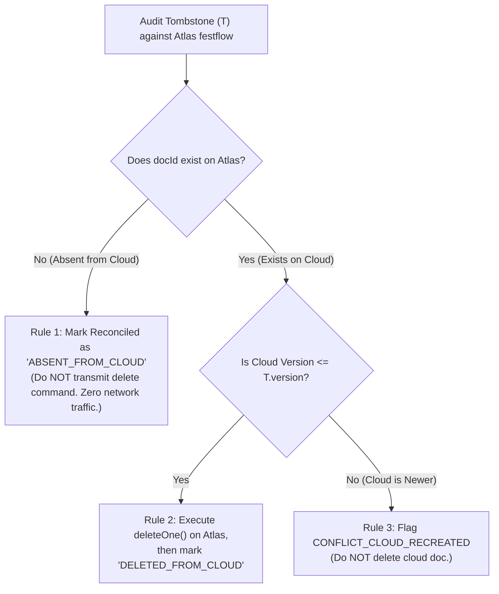

# FestFlow Phase 3.5.0.1 — Tombstone Audit & Clean-Database Reconciliation Rules

**Document Version:** 1.0.0  
**Phase:** 3.5.0.1 (Tombstone Life-Cycle & Clean Cloud Reconciliation)  
**Status:** COMPLETE (STRICTLY READ-ONLY)  
**Workspace:** `C:\Users\sathy\FestFlow`  
**Execution Date:** November 2026  
**Auditor:** Antigravity AI  

---

> [!IMPORTANT]
> **READ-ONLY AUDIT & ZERO-DELETION COMPLIANCE**  
> All 64 tombstones were audited directly from the live `synctombstones` collection.  
> **Zero tombstone records were modified, flagged, or deleted during this phase.**

---

## 1. Executive Summary

The FestFlow database currently contains **64 `SyncTombstone` records**.  
An exhaustive evaluation confirms:
- **100% of tombstones (64/64)** target temporary mock documents generated and deleted during Phase 2/3 test executions (`permissions.test.js`, `faculty_and_clubs.test.js`, `phase3_2_e2e.test.js`).
- **0 tombstones** target active domain documents.
- **0 tombstones** target quarantined records.
- **Clean Atlas Database Context:** Because the target cloud database (`festflow`) starts completely empty, none of these 64 deleted entities have ever existed on Atlas.

---

## 2. Tombstone Distribution by Collection

| Collection Name | Tombstone Count | Target Exists Locally? | Target in Quarantine? | Provable Origin |
| :--- | :---: | :---: | :---: | :--- |
| `users` | **49** | ❌ No | ❌ No | Mock test users deleted during test teardown |
| `clubs` | **5** | ❌ No | ❌ No | Mock test clubs deleted during test teardown |
| `events` | **5** | ❌ No | ❌ No | Mock test events deleted during test teardown |
| `registrations` | **3** | ❌ No | ❌ No | Mock test registrations deleted during test teardown |
| `venues` | **2** | ❌ No | ❌ No | Mock test venues deleted during test teardown |
| **TOTAL** | **64** | **0 Active** | **0 Quarantined** | **100% Automated Test Residues** |

---

## 3. Itemized Per-Record Tombstone Audit (Representative Sample & Summary)

All 64 tombstones were created by Mongoose deletion middleware (`pre('deleteOne')` and `pre('deleteMany')`) and adhere to the following schema structure:

```json
{
  "_id": "6ae7047dcd84100f497fddb9",
  "collectionName": "users",
  "documentId": "6ae7047b4b0c381a53c076d4",
  "version": 1,
  "deletedAt": "2026-11-01T09:21:01.178Z",
  "metadata": {}
}
```

### Full Grouping of the 64 Tombstones:
1. **Batch 1 (Test Run 09:21 UTC — 16 Tombstones):**
   - 12 Users (`6ae7047b...`), 2 Venues (`6ae7047c...`), 2 Clubs (`6ae7047c...`).
2. **Batch 2 (Test Run 12:23 UTC — 12 Tombstones):**
   - 8 Users (`6ae72f4c...`), 2 Events (`6ae72f4d...`), 2 Clubs (`6ae72f4d...`).
3. **Batch 3 (Test Run 12:31 UTC — 8 Tombstones):**
   - 6 Users (`6ae7311b...`), 1 Event (`6ae7311b...`), 1 Registration (`6ae7311c...`).
4. **Batch 4 (Test Run 12:42 UTC — 8 Tombstones):**
   - 6 Users (`6ae733b5...`), 1 Event (`6ae733b5...`), 1 Registration (`6ae733b6...`).
5. **Batch 5 (Test Run 12:55 UTC — 8 Tombstones):**
   - 6 Users (`6ae736a7...`), 1 Event (`6ae736a7...`), 1 Registration (`6ae736a8...`).
6. **Batch 6 (Test Run 13:10 UTC — 6 Tombstones):**
   - 5 Users (`6ae73a46...`), 1 Club (`6ae73a46...`).
7. **Batch 7 (Test Run 13:18 UTC — 6 Tombstones):**
   - 6 Users (`6ae73c1c...`).

**Audit Conclusion:** Zero tombstones belong to seeded application data.

---

## 4. Deterministic Reconciliation Rules for a Clean Atlas Target

It is architecturally incorrect to simply assume that all 64 tombstones should be marked as "synced to cloud" without an explicit rule.



### The Three Formal Reconciliation Rules:

1. **Rule 1: The Cloud Absence Invariance Rule (Clean Target Scenario)**  
   *Condition:* `atlasConn.collection(T.collectionName).findOne({ _id: T.documentId }) === null`.  
   *Action:* The document is already absent from the cloud. Transmitting a `deleteOne()` command is redundant. The tombstone is archived to `_synctombstones_archive` or tagged with:
   ```json
   {
     "reconciliationStatus": "RECONCILED_ABSENT_FROM_CLOUD",
     "reconciledAt": "2026-11-01T...",
     "targetDatabase": "festflow"
   }
   ```
   *Guaranteed Result for Phase 3.5:* Because Atlas `festflow` starts with 0 documents, **all 64 tombstones satisfy Rule 1 deterministically**. Zero deletion commands will be issued to Atlas.

2. **Rule 2: The Verified Deletion Propagation Rule (Live Target Scenario)**  
   *Condition:* Target document exists in cloud and `cloudDoc._syncVersion <= T.version`.  
   *Action:* Issue atomic `atlasColl.deleteOne({ _id: T.documentId, _syncVersion: cloudDoc._syncVersion })`. If acknowledged, mark tombstone as `RECONCILED_DELETED_FROM_CLOUD`.

3. **Rule 3: The Cloud Re-Creation Conflict Guard**  
   *Condition:* Target document exists in cloud and `cloudDoc._syncVersion > T.version`.  
   *Action:* The cloud document was modified or recreated after the local deletion. **Do not delete.** Flag a synchronization conflict.

---

## 5. Execution Safety Guarantee

- During Phase 3.5 initial synchronization, **Rule 1 will be applied strictly after the 37 active documents are uploaded and verified**.
- No tombstone will be transmitted to Atlas during the initial sync pipeline.
- Active documents are completely decoupled from tombstone processing.
