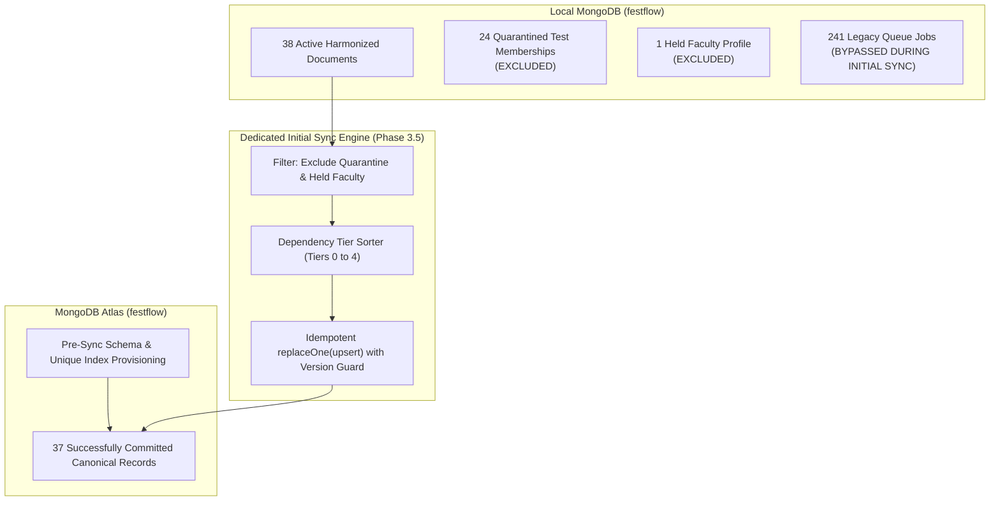
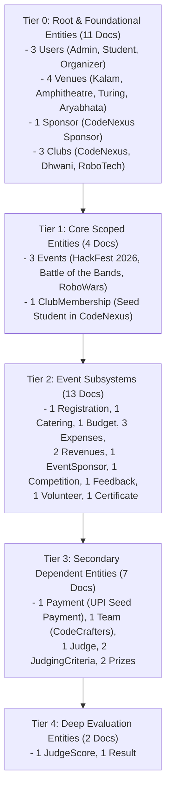

# FestFlow Phase 3.5.0 — Initial Synchronization Architecture & Safety Design

**Document Version:** 1.0.0  
**Phase:** 3.5.0 (Initial Cloud Synchronization Architecture & Gating)  
**Status:** DRAFT FOR HUMAN REVIEW & APPROVAL (DESIGN ONLY)  
**Workspace:** `C:\Users\sathy\FestFlow`  
**Execution Date:** November 2026  
**Auditor:** Antigravity AI  

---

## 1. Executive Summary & Core Philosophy

The audits in `PHASE3_5_0_QUEUE_AUDIT.md` and `PHASE3_5_0_TOMBSTONE_AUDIT.md` established that the legacy `SyncQueue` (241 jobs) and `SyncTombstones` (64 records) contain historical test residues.  
Attempting to populate the clean MongoDB Atlas `festflow` database by simply starting the worker on the un-compacted queue would attempt to insert 165 deleted mock entities and reprocess 38 quarantined memberships.

### The Decoupled Initial-Sync Architecture



**Key Architectural Rules:**
1. **Decoupled Engine:** Initial synchronization operates through a dedicated, standalone `initialSyncService.js` script that takes a clean, read-only snapshot of the active local database and uploads documents in dependency tier order.
2. **Exclusion of Non-Eligible Records:**
   - The 24 quarantined test memberships in `_orphaned_clubmemberships_backup` are strictly excluded.
   - The 1 held faculty profile (`faculty@festflow.edu`) is strictly excluded.
   - Total eligible records for initial upload: **37 documents**.
3. **Canonical Local ObjectIds:** All 37 documents retain their original local `_id` values.
4. **Pre-Sync Schema & Index Provisioning:** Unique indexes and schemas are verified on Atlas `festflow` *before* the first document is transmitted.
5. **Post-Sync Queue Alignment:** Once initial sync is verified on Atlas, the queue jobs corresponding to the 37 uploaded records are transitioned to `status: 'synced'`, and the 203 obsolete test jobs are archived.

---

## 2. Dependency-Ordered Upload Tiers (37 Eligible Documents)

To guarantee that no child record is uploaded before its foreign key parent exists on Atlas, the 37 eligible documents are divided into five sequential batches:



### Detailed Batch Specifications

| Batch | Tier | Target Collections | Document Count | Parent Dependency Requirements | Verification Gate Before Next Batch |
| :---: | :---: | :--- | :---: | :--- | :--- |
| **1** | **0** | `users` (3), `venues` (4), `sponsors` (1), `clubs` (3) | **11** | None (Root entities). | Assert 11 documents committed on Atlas `festflow`. |
| **2** | **1** | `events` (3), `clubmemberships` (1) | **4** | Requires `clubs`, `venues`, `users` from Batch 1. | Assert parent IDs exist on Atlas before upload. |
| **3** | **2** | `registrations` (1), `caterings` (1), `budgets` (1), `expenses` (3), `revenues` (2), `eventsponsors` (1), `competitions` (1), `feedbacks` (1), `volunteers` (1), `certificates` (1) | **13** | Requires `events` and `users` from Batches 1 & 2. | Assert all foreign keys resolve on Atlas. |
| **4** | **3** | `payments` (1), `teams` (1), `judges` (1), `judgingcriterias` (2), `prizes` (2) | **7** | Requires `registrations`, `competitions`, `users`. | Assert all foreign keys resolve on Atlas. |
| **5** | **4** | `judgescores` (1), `results` (1) | **2** | Requires `judges`, `teams`, `competitions`. | Assert all foreign keys resolve on Atlas. |
| **TOTAL** | | **All 23 Domain Collections** | **37** | **Zero Broken References** | Final count assertion on Atlas: exactly 37. |

---

## 3. Schema & Unique Index Provisioning Protocol

Before a single document is inserted into Atlas `festflow`, the schema structure and index constraints must be provisioned.

```javascript
/**
 * Pre-Sync Atlas Schema & Index Provisioning
 */
async function provisionAtlasIndexes(atlasConn) {
  const models = [
    User, Venue, Club, Event, ClubMembership, Registration,
    Catering, Budget, Expense, Revenue, EventSponsor, Competition,
    Feedback, Volunteer, Certificate, Payment, Team, Judge,
    JudgingCriteria, Prize, JudgeScore, Result, Sponsor
  ];

  console.log('Provisioning unique indexes and validation schemas on Atlas festflow...');
  for (const model of models) {
    const collName = model.collection.name;
    const atlasColl = atlasConn.collection(collName);
    
    // Extract indexes defined in Mongoose schema
    const schemaIndexes = model.schema.indexes();
    for (const [fields, options] of schemaIndexes) {
      await atlasColl.createIndex(fields, options || {});
    }
    console.log(`   ✅ Indexes provisioned for '${collName}'`);
  }
}
```
**Benefits:**
- Prevents race conditions during child uploads.
- Guarantees that unique constraints (`email`, `name`, `certificateNo`, `transactionId`) are enforced at the database level on Atlas from Day 1.

---

## 4. Idempotency & Version Guarding Semantics

### 4.1 Monotonic Version Guard
To prevent an old queue job or stale retry from overwriting newer cloud data, every document upload executes with an atomic version filter:

```javascript
/**
 * Idempotent Upload with Optimistic Version Guard
 */
async function uploadDocumentWithVersionGuard(atlasColl, doc) {
  const result = await atlasColl.updateOne(
    {
      _id: doc._id,
      $or: [
        { _syncVersion: { $lt: doc._syncVersion } },
        { _syncVersion: { $exists: false } }
      ]
    },
    { $set: doc },
    { upsert: true }
  );
  return result;
}
```
- **If Atlas does not have the document:** The upsert inserts the document under its canonical `_id`.
- **If Atlas has an older version:** The update sets the newer document.
- **If Atlas already has the same or newer version:** The update is a no-op (`matchedCount: 1, modifiedCount: 0`), preventing obsolete overwrites.

### 4.2 Preservation of BSON Types
All dates (`createdAt`, `updatedAt`, `establishmentDate`, `paymentDate`, `issueDate`), subdocument arrays (`facilities`, `members`), and BSON ObjectIds are transmitted directly using native BSON serialization, guaranteeing zero truncation or stringification.

---

## 5. Initial-Sync Isolation & Queue Coexistence Safeguards

| Hazard | Risk Description | Safeguard Mechanism |
| :--- | :--- | :--- |
| **Duplicate Queue Processing** | Legacy worker picking up pending jobs while initial sync runs. | **Worker Disabled:** The background sync worker process is stopped. Initial sync runs via dedicated standalone CLI. |
| **Old Payload Overwrite** | Legacy queue jobs containing old payloads overwriting fresh local data. | **Version Guard:** Upload uses `$or: [{ _syncVersion: { $lt: doc._syncVersion } }]`. Stale jobs cannot overwrite newer versions. |
| **Premature Child Uploads** | Child record syncing before parent entity is committed on Atlas. | **Strict Tier Gating:** Batch $N+1$ does not start until Batch $N$ reports 100% write acknowledgments. |
| **Quarantine Leakage** | Quarantined test memberships uploading to cloud. | **Collection Isolation:** Quarantined records reside in `_orphaned_clubmemberships_backup`, which is excluded from the domain model sync registry. |
| **Faculty Profile Exposure** | Unverified faculty profile uploading without stakeholder agreement. | **Explicit Exclusion Filter:** User query explicitly excludes `email: 'faculty@festflow.edu'`. |
| **Worker Restart Mid-Sync** | Server reboot interrupting initial sync. | **State Checkpointing:** Each batch records its progress in an offline sync manifest; resuming sync skips already-committed batches idempotently. |
| **Deletion Propagation** | 64 legacy tombstones deleting records on cloud. | **Tombstone Bypass:** Tombstones are not processed during initial sync. |
