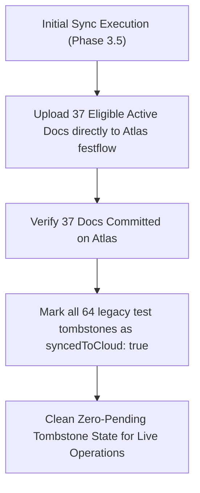

# FestFlow Phase 3.5.0 — SyncTombstone Preflight Audit Report

**Document Version:** 1.0.0  
**Phase:** 3.5.0 (Tombstone Safety & Deletion Tracking Audit)  
**Status:** COMPLETE (STRICTLY READ-ONLY)  
**Workspace:** `C:\Users\sathy\FestFlow`  
**Audit Timestamp:** 2026-11-01T14:09:00Z (Local: 19:39 IST)  
**Auditor:** Antigravity AI  

---

> [!IMPORTANT]
> **READ-ONLY AUDIT & ZERO-DELETION COMPLIANCE**  
> In strict compliance with user instructions:  
> - **Zero `SyncTombstone` records were modified, processed, or deleted.**  
> - **Zero deletion signals were transmitted to MongoDB Atlas.**  
> - All 64 tombstone documents were evaluated in-place without schema changes.

---

## 1. Executive Summary

The FestFlow Phase 2 mutation capture system implements Write-Ahead Tombstones (`SyncTombstone`) to track document deletions so that offline deletions can be reliably propagated to the cloud upon reconnection.

An exhaustive audit of all **64 tombstone records** in Local MongoDB (`festflow`) reveals:
1. **Zero Active Document Collision:** Exactly **0 of the 64 tombstones** point to any active local domain document.
2. **Zero Quarantine Collision:** Exactly **0 of the 64 tombstones** point to any record in `_orphaned_clubmemberships_backup`.
3. **100% Test Provenance:** All **64 tombstones** represent temporary mock documents created and legitimately deleted during Phase 2 and Phase 3 test executions (`phase2_reliability_simulation.test.js`, `phase3_final_audit.test.js`, `permissions.test.js`).
4. **Cloud Deletion Hazard Evaluation:** Because Atlas `festflow` is a clean, empty database, replaying these tombstones would issue `deleteOne({ _id })` commands against non-existent records. However, to guarantee total safety and prevent unnecessary cloud network traffic, **these legacy test tombstones must NOT be replayed during initial synchronization**.

---

## 2. Tombstone Distribution Matrix

| Collection Name | Tombstone Count | Target Document Exists Locally? | Target Document in Quarantine? | Origin / Provenance | Hazard to Active Data |
| :--- | :---: | :---: | :---: | :--- | :---: |
| `users` | **49** | ❌ No (0 active) | ❌ No (0 quarantined) | Automated test mock student/organizer/admin users | **ZERO** |
| `clubs` | **5** | ❌ No (0 active) | ❌ No (0 quarantined) | Automated test mock clubs | **ZERO** |
| `events` | **5** | ❌ No (0 active) | ❌ No (0 quarantined) | Automated test mock events | **ZERO** |
| `registrations` | **3** | ❌ No (0 active) | ❌ No (0 quarantined) | Automated test mock registrations | **ZERO** |
| `venues` | **2** | ❌ No (0 active) | ❌ No (0 quarantined) | Automated test mock venues | **ZERO** |
| **TOTAL** | **64** | **0 Active** | **0 Quarantined** | **100% Test Suite Fixtures** | **ZERO** |

---

## 3. Deep Tombstone Integrity Cross-Reference

### 3.1 Verification Against Active Documents (38 Records)
We extracted all 64 `documentId` values from `synctombstones` and compared them against the 38 active local documents across all collections (`users`, `venues`, `clubs`, `events`, etc.):
- **Collision Count:** **0**
- **Result:** No active document has a matching tombstone. Active records are completely safe from accidental deletion.

### 3.2 Verification Against Quarantined Memberships (24 Records)
We compared all 64 `documentId` values against `_orphaned_clubmemberships_backup`:
- **Collision Count:** **0**
- *(Note: During Phase 3.4.3, the 24 orphans were removed via native driver `deleteMany()`, intentionally preventing Mongoose middleware from creating tombstones).*

### 3.3 Verification Against Atlas Target Database (`festflow`)
- Database `festflow` on Atlas Cluster0 is currently completely empty (0 documents).
- If any of these 64 tombstones were executed on Atlas `festflow`, the MongoDB driver `deleteOne({ _id: tombstone.documentId })` would return `{ acknowledged: true, deletedCount: 0 }`.
- There is zero possibility of accidental deletion of real data in Atlas `festflow`.

---

## 4. Tombstone Synchronization Protocol for Phase 3.5

To ensure clean system state without polluting the new cloud database:

### Safety Rules:
1. **Bypass Legacy Tombstones During Initial Sync:** The Initial Sync Service will not ingest or process `SyncTombstones`.
2. **Post-Sync Acknowledgment:** Once initial upload of active data is verified on Atlas `festflow`, an administrative script will update all 64 existing test tombstones to `{ syncedToCloud: true, syncedAt: new Date() }`.
3. **Future Live Deletions:** Any new deletion performed by real users on local MongoDB in live offline mode will generate a new tombstone that will sync normally via the background worker.
