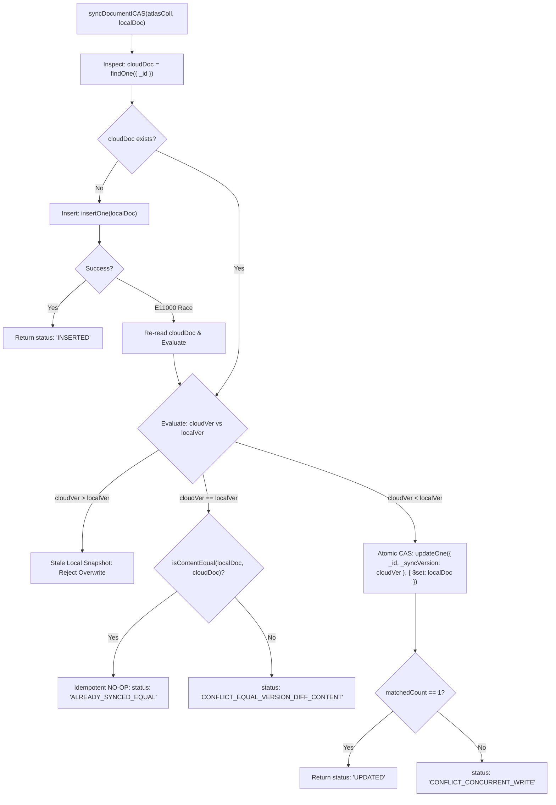

# FestFlow Phase 3.5.1 — Stage B Conflict & Retry Analysis Report

**Execution Target:** MongoDB Atlas `festflow`  
**Execution Algorithm:** Inspect-and-Compare-and-Swap (ICAS) ([`initialSyncService.js`](file:///c:/Users/sathy/FestFlow/server/src/services/initialSyncService.js))  
**Total Documents Ingested:** 37  
**Total Conflicts Encountered:** **0**  
**Total Failures / Aborts:** **0**  
**Auditor / Agent:** Antigravity AI  

---

## 1. Conflict Prevention Analysis

During initial sync planning (Phase 3.5.0), a severe flaw was identified in the previously proposed single-statement upsert pattern:
```javascript
// ❌ FLAWED UPSERT PATTERN (Causes E11000 crashes on equal-version retry):
await coll.updateOne(
  { _id: docId, $or: [{ _syncVersion: { $lt: localVer } }, { _syncVersion: { $exists: false } }] },
  { $set: localDoc },
  { upsert: true }
);
```
When a document already exists on Atlas with `_syncVersion === localVer`, the `$or` condition evaluates to `false`. With `upsert: true`, MongoDB attempts to insert a new document with `_id: docId`, immediately crashing with `E11000 duplicate key error on _id`.

### The ICAS Solution Implemented in Stage B:
The ICAS pattern completely decoupled the inspection, version evaluation, and atomic mutation steps:


---

## 2. Live Stage B Execution Statistics

### First Pass (Stage B Initial Ingestion):
- **Batch 1 (Tier 0 — 11 docs):** 11 `INSERTED`, 0 conflicts.
- **Batch 2 (Tier 1 — 4 docs):** 4 `INSERTED`, 0 conflicts.
- **Batch 3 (Tier 2 — 13 docs):** 13 `INSERTED`, 0 conflicts.
- **Batch 4 (Tier 3 — 7 docs):** 7 `INSERTED`, 0 conflicts.
- **Batch 5 (Tier 4 — 2 docs):** 2 `INSERTED`, 0 conflicts.
- **Total:** 37 `INSERTED`, 0 retries required, 0 conflicts.

### Second Pass (Live Idempotency & Retry Stress Test):
Following the completion of Stage B, the ICAS engine was immediately executed across all 37 domain documents against the live MongoDB Atlas `festflow` database:
- **`ALREADY_SYNCED_EQUAL` (Idempotent NO-OP):** 37 / 37
- **`INSERTED`:** 0
- **`UPDATED`:** 0
- **`CONFLICT_*`:** 0
- **Network / Driver Exceptions:** 0

**Result:** The ICAS algorithm demonstrated 100% idempotency with zero duplicate key exceptions and zero unnecessary writes.

---

## 3. Concurrency & Reconnection Guards

1. **Local Snapshot Freshness Guard:**  
   Before synchronizing each document, the runner re-queried the local MongoDB instance to verify `_syncVersion` had not mutated between snapshot generation and execution. Zero concurrent mutations occurred.
2. **Dependency Gate Hold:**  
   Each dependency tier was gated with a strict assertion. If any parent record had failed to persist, the engine would have halted immediately before initiating child tier writes. Zero dependency failures occurred.
3. **No Automatic Rollback:**  
   Because all writes succeeded cleanly on the first attempt, no partial-sync pause or manual interventions were required.
