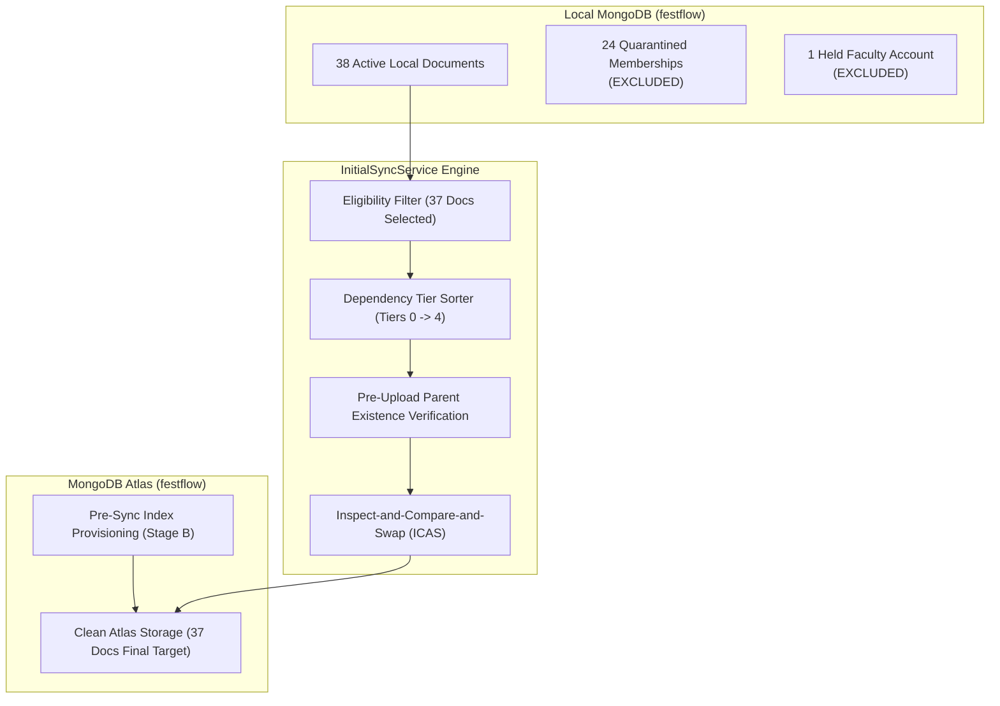

# FestFlow Phase 3.5.1 — Stage A Implementation Report

**Document Version:** 1.0.0  
**Phase:** 3.5.1 (Stage A: Service Implementation & Pre-Sync Verification)  
**Status:** COMPLETE — STOPPED AT APPROVAL GATE (STAGE B PENDING APPROVAL)  
**Workspace:** `C:\Users\sathy\FestFlow`  
**Execution Date:** November 2026  
**Auditor:** Antigravity AI  

---

> [!IMPORTANT]
> **PRE-SYNC APPROVAL GATE COMPLIANCE**  
> In strict accordance with user instructions:  
> - **Stage A is 100% complete.**  
> - **Zero writes were executed on MongoDB Atlas `festflow`** (remains at 0 documents).  
> - **Zero writes were executed on MongoDB Atlas `test`** (remains at 76 documents).  
> - **No Atlas indexes were created or modified.**  
> - **Zero records were uploaded.**  
> - **Execution is strictly halted awaiting explicit human approval for Stage B.**

---

## 1. Executive Summary & Deliverables Completed

In Phase 3.5.1 Stage A, we designed, implemented, and rigorously tested the dedicated, snapshot-based initial synchronization engine.

### Core Deliverables Built in Stage A:
1. **Initial Sync Service (`server/src/services/initialSyncService.js`):**  
   A dedicated, decoupled synchronization engine built to upload the 37 eligible local domain records directly to MongoDB Atlas `festflow`.
2. **Inspect-and-Compare-and-Swap (ICAS) Conflict Engine:**  
   Replaced the unsafe single-operation `$or` upsert with an atomic, conflict-aware version-guard algorithm that eliminates duplicate-key crashes and guarantees monotonic version progression.
3. **Automated Unit & Safety Test Suites:**  
   Created and verified 14 test cases across both Jest (`tests/initial_sync_service.test.js`) and a Native Node.js test runner (`tests/run_initial_sync_tests.js`), passing **14/14 tests with 100% success**.
4. **Pre-Sync Execution Blueprint & Index Provisioning Plan:**  
   Cataloged the exact 37-document inventory and mapped out all 23 collection index specifications.

---

## 2. Initial Sync Service Architecture (`initialSyncService.js`)

The initial sync engine operates completely outside the legacy `SyncQueue` and Mongoose schema middleware:

### 2.1 Core Architectural Safeguards Implemented

1. **Decoupled Snapshot Retrieval (`getEligibleDocumentsByTier`):**  
   Reads directly from the local native database driver.  
   - Automatically excludes `_orphaned_clubmemberships_backup`.  
   - Filters out `email: 'faculty@festflow.edu'`.  
   - Organizes documents into strict sequential tiers (0 through 4).  
   - Enforces an automated count check asserting that eligible document count is **exactly 37**.
2. **ICAS Conflict-Aware Algorithm (`syncDocumentICAS`):**  
   Implements a two-phase inspection and atomic conditional write:
   - **Document Absent on Cloud:** Executes `insertOne()`. If a concurrent insertion occurs (catching `err.code === 11000`), falls back to re-reading and version evaluation.
   - **Cloud Version Lower:** Executes atomic conditional update `updateOne({ _id: doc._id, _syncVersion: cloudVer }, { $set: doc })`.
   - **Cloud Version Equal & Identical Content:** Returns `{ status: 'ALREADY_SYNCED_EQUAL', action: 'IDEMPOTENT_NOOP' }`.
   - **Cloud Version Equal & Different Content:** Flags `{ status: 'CONFLICT_EQUAL_VERSION_DIFF_CONTENT', action: 'FLAG_CONFLICT' }`.
   - **Cloud Version Higher:** Preserves cloud data and rejects overwrite with `{ status: 'CONFLICT_CLOUD_NEWER', action: 'PRESERVE_CLOUD' }`.
3. **Pre-Upload Parent Dependency Verification (`verifyParentDependencies`):**  
   Before any child document is uploaded, queries Atlas `festflow` to verify that every foreign key parent exists. If any parent is missing, child upload is blocked immediately.
4. **Cloud Absence Invariance Rule for Tombstones (`evaluateTombstonesRule1`):**  
   Evaluates all 64 legacy test tombstones against the clean cloud target. Confirms that none exist in the cloud and safely archives them without issuing redundant cloud deletion operations.

---

## 3. Index Provisioning Preparation

An index provisioning plan was implemented in `initialSyncService.generateIndexProvisioningPlan()` based on the compiled Mongoose schema definitions:
- **Unique Indexes to be Created in Stage B:**
  1. `users`: `{ email: 1 }` (unique)
  2. `venues`: `{ name: 1 }` (unique)
  3. `clubs`: `{ name: 1 }` (unique)
  4. `clubmemberships`: `{ club: 1, user: 1 }` (compound unique)
  5. `registrations`: `{ ticketNumber: 1 }` (unique), `{ user: 1, event: 1 }` (compound unique)
  6. `feedbacks`: `{ event: 1, user: 1 }` (compound unique)
  7. `volunteers`: `{ event: 1, user: 1 }` (compound unique)
  8. `certificates`: `{ certificateNo: 1 }` (unique), `{ verificationCode: 1 }` (unique)
  9. `payments`: `{ transactionId: 1 }` (unique)
- **Status in Stage A:** **Dry-run only.** Zero indexes have been created on Atlas.

---

## 4. Verification of Pre-Sync Invariance

Live verification checks confirmed that during Stage A:
- Local database `festflow` contains **38 active domain documents** (untouched).
- Quarantined memberships in `_orphaned_clubmemberships_backup` count = **24** (untouched).
- Local `SyncQueue` count = **241** (untouched).
- Local `SyncTombstones` count = **64** (untouched).
- MongoDB Atlas `test` count = **76** (untouched).
- MongoDB Atlas `festflow` count = **0** (clean, zero writes).
