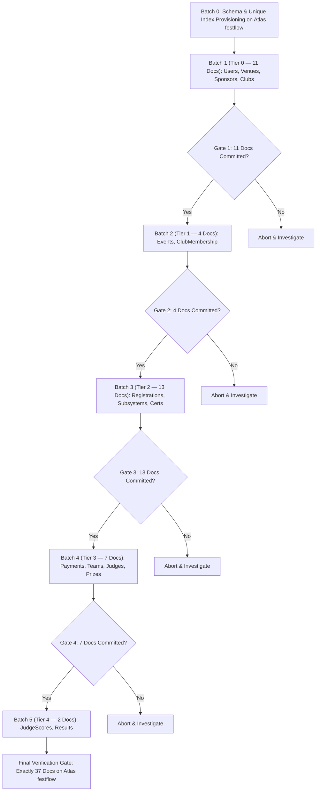

# FestFlow Phase 3.5.1 — Stage B Pre-Sync Execution Plan & Human Approval Gate

**Document Version:** 1.0.0  
**Phase:** 3.5.1 (Pre-Sync Execution Blueprint & Approval Request)  
**Status:** DRAFT FOR HUMAN REVIEW & APPROVAL (STAGE B ON HOLD)  
**Workspace:** `C:\Users\sathy\FestFlow`  
**Execution Date:** November 2026  
**Auditor:** Antigravity AI  

---

> [!CAUTION]
> **PRE-SYNC HUMAN APPROVAL GATE: EXECUTION IS HALTED**  
> In accordance with user instructions:  
> - **Stage A implementation and testing are complete.**  
> - **Stage B (initial cloud upload to MongoDB Atlas) is STRICTLY ON HOLD.**  
> - **Zero documents have been uploaded to Atlas.**  
> - **Zero Atlas indexes have been created.**  
> Execution will not proceed to Stage B until the human stakeholder reviews this execution plan and provides explicit authorization.

---

## 1. Exact 37-Document Candidate Inventory

Below is the definitive, record-level inventory of all 37 documents scheduled for initial upload to MongoDB Atlas `festflow`:

| # | Dependency Tier | Collection Name | Canonical Local `_id` | Document Summary / Identifier | Document Version |
| :-: | :---: | :--- | :--- | :--- | :---: |
| **1** | **Tier 0** | `users` | `6ae70115a2ab160fb98025bf` | `admin@festflow.edu` (Dr. Rajesh Sharma) | 1 |
| **2** | **Tier 0** | `users` | `6ae70115a2ab160fb98025c1` | `organizer@festflow.edu` (Aarav Mehta) | 1 |
| **3** | **Tier 0** | `users` | `6ae70115a2ab160fb98025c3` | `student@festflow.edu` (Ananya Iyer) | 1 |
| **4** | **Tier 0** | `venues` | `6ae70116a2ab160fb98025c7` | Dr. APJ Abdul Kalam Auditorium (Cap: 800) | 1 |
| **5** | **Tier 0** | `venues` | `6ae70116a2ab160fb98025cc` | Alan Turing Advanced Computing Lab (Cap: 120) | 1 |
| **6** | **Tier 0** | `venues` | `6ae70116a2ab160fb98025d0` | Open Air Amphitheatre (Cap: 1500) | 1 |
| **7** | **Tier 0** | `venues` | `6ae70116a2ab160fb98025d4` | Aryabhata Seminar Hall (Cap: 250) | 1 |
| **8** | **Tier 0** | `sponsors` | `6ae7011740e5a2d1e84d5bc9` | TechCorp Global | 1 |
| **9** | **Tier 0** | `clubs` | `6ae70116a2ab160fb98025db` | CodeNexus Developers Club | 1 |
| **10**| **Tier 0** | `clubs` | `6ae70116a2ab160fb98025dc` | Dhwani Cultural & Music Society | 1 |
| **11**| **Tier 0** | `clubs` | `6ae70116a2ab160fb98025dd` | RoboTech Innovation Club | 1 |
| **12**| **Tier 1** | `events` | `6ae70116a2ab160fb98025e1` | HackFest 2026 | 1 |
| **13**| **Tier 1** | `events` | `6ae70116a2ab160fb98025e2` | Battle of the Bands | 1 |
| **14**| **Tier 1** | `events` | `6ae70116a2ab160fb98025e3` | RoboWars Exhibition & Challenge | 1 |
| **15**| **Tier 1** | `clubmemberships`| `6ae7011740e5a2d1e84d5bad`| Ananya Iyer in CodeNexus Developers Club | 1 |
| **16**| **Tier 2** | `registrations`| `6ae70116a2ab160fb98025e7` | RoboWars Registration (Ticket: TKT-2026-FEST-001) | 1 |
| **17**| **Tier 2** | `caterings` | `6ae7011740e5a2d1e84d5bcf` | HackFest Event Catering | 1 |
| **18**| **Tier 2** | `budgets` | `6ae7011740e5a2d1e84d5bbc` | HackFest Overall Event Budget | 1 |
| **19**| **Tier 2** | `expenses` | `6ae7011740e5a2d1e84d5bbe` | Venue Setup Expense | 1 |
| **20**| **Tier 2** | `expenses` | `6ae7011740e5a2d1e84d5bbf` | Audio/Visual Equipment Rental | 1 |
| **21**| **Tier 2** | `expenses` | `6ae7011740e5a2d1e84d5bc0` | Participant Refreshments | 1 |
| **22**| **Tier 2** | `revenues` | `6ae7011740e5a2d1e84d5bc4` | HackFest Ticket Sales Revenue | 1 |
| **23**| **Tier 2** | `revenues` | `6ae7011740e5a2d1e84d5bc5` | Corporate Title Sponsorship Revenue | 1 |
| **24**| **Tier 2** | `eventsponsors`| `6ae7011740e5a2d1e84d5bcc`| TechCorp Platinum Event Sponsorship | 1 |
| **25**| **Tier 2** | `competitions` | `6ae7011740e5a2d1e84d5bd5` | 24-Hour Hackathon Main Track | 1 |
| **26**| **Tier 2** | `feedbacks` | `6ae7011740e5a2d1e84d5bb6` | Student RoboWars Feedback (Rating: 5/5) | 1 |
| **27**| **Tier 2** | `volunteers` | `6ae7011740e5a2d1e84d5bb9` | Student Volunteer Registration | 1 |
| **28**| **Tier 2** | `certificates` | `6ae7011740e5a2d1e84d5bb3` | CERT-2026-FEST-001 (Verification: V-FEST26-8812) | 1 |
| **29**| **Tier 3** | `payments` | `6ae7011740e5a2d1e84d5bb0` | TXN-INIT-2026-UPI99 (Amount: 0, Status: completed) | 1 |
| **30**| **Tier 3** | `teams` | `6ae7011740e5a2d1e84d5bd7` | CodeCrafters Team (Leader: Ananya Iyer) | 1 |
| **31**| **Tier 3** | `judges` | `6ae7011740e5a2d1e84d5bdf` | HackFest External Technical Judge | 1 |
| **32**| **Tier 3** | `judgingcriterias`|`6ae7011740e5a2d1e84d5bdb`| Code Quality & Architecture (Weight: 40%) | 1 |
| **33**| **Tier 3** | `judgingcriterias`|`6ae7011740e5a2d1e84d5bdd`| Innovation & Impact (Weight: 60%) | 1 |
| **34**| **Tier 3** | `prizes` | `6ae7011740e5a2d1e84d5be3` | 1st Place Cash Prize (Rs. 25,000) | 1 |
| **35**| **Tier 3** | `prizes` | `6ae7011740e5a2d1e84d5be5` | 2nd Place Runner-Up (Rs. 15,000) | 1 |
| **36**| **Tier 4** | `judgescores` | `6ae7011740e5a2d1e84d5be1` | Evaluation Score (Score: 92/100) | 1 |
| **37**| **Tier 4** | `results` | `6ae7011740e5a2d1e84d5be7` | HackFest 2026 Official Results | 1 |

---

## 2. Verification of Exclusions

1. **Quarantined Memberships (24 Documents):**  
   All 24 orphaned membership records remain isolated in `_orphaned_clubmemberships_backup`. None are included in the initial-sync candidate set.
2. **Faculty Record (`faculty@festflow.edu`):**  
   User document `6ae70115a2ab160fb98025c5` is held offline pending manual identity verification. It will not be uploaded in Stage B.

---

## 3. Sequential Dependency-Tier Upload Plan

When authorized, Stage B will execute uploads in five strictly gated sequential batches:



---

## 4. Expected Cloud Document Counts Following Stage B

| Collection Name | Pre-Sync Atlas `festflow` Count | Stage B Ingested Count | Final Expected Atlas `festflow` Count | Final Atlas `test` Count |
| :--- | :---: | :---: | :---: | :---: |
| `users` | 0 | 3 | **3** | 5 (Untouched) |
| `venues` | 0 | 4 | **4** | 4 (Untouched) |
| `sponsors` | 0 | 1 | **1** | 2 (Untouched) |
| `clubs` | 0 | 3 | **3** | 3 (Untouched) |
| `events` | 0 | 3 | **3** | 1 (Untouched) |
| `clubmemberships` | 0 | 1 | **1** | 30 (Untouched) |
| `registrations` | 0 | 1 | **1** | 1 (Untouched) |
| `caterings` | 0 | 1 | **1** | 3 (Untouched) |
| `budgets` | 0 | 1 | **1** | 1 (Untouched) |
| `expenses` | 0 | 3 | **3** | 5 (Untouched) |
| `revenues` | 0 | 2 | **2** | 4 (Untouched) |
| `eventsponsors` | 0 | 1 | **1** | 2 (Untouched) |
| `competitions` | 0 | 1 | **1** | 1 (Untouched) |
| `feedbacks` | 0 | 1 | **1** | 1 (Untouched) |
| `volunteers` | 0 | 1 | **1** | 1 (Untouched) |
| `certificates` | 0 | 1 | **1** | 1 (Untouched) |
| `payments` | 0 | 1 | **1** | 2 (Untouched) |
| `teams` | 0 | 1 | **1** | 2 (Untouched) |
| `judges` | 0 | 1 | **1** | 1 (Untouched) |
| `judgingcriterias` | 0 | 2 | **2** | 2 (Untouched) |
| `prizes` | 0 | 2 | **2** | 2 (Untouched) |
| `judgescores` | 0 | 1 | **1** | 1 (Untouched) |
| `results` | 0 | 1 | **1** | 1 (Untouched) |
| **TOTAL** | **0** | **37** | **37** | **76 (Untouched)** |

---

## 5. Rollback Strategy for Stage B Failures

In the event of an unhandled network error, unexpected cloud document, or constraint violation:
1. **Immediate Execution Stop:** The upload pipeline stops instantly. Subsequent batches are NOT attempted.
2. **No Automatic Destructive Cloud Deletion:** Successfully uploaded documents remain on Atlas to prevent churn; their status is recorded in the sync manifest.
3. **Resumption Capability:** Because all writes use the idempotent ICAS algorithm, re-running the sync service will safely skip already-inserted documents (`ALREADY_SYNCED_EQUAL`) and resume with the uncompleted batch.
4. **Emergency Clean-Slate Cloud Reset (If Requested by Human):**  
   If human stakeholders request a complete restart, the target database can be dropped cleanly:
   ```javascript
   // Emergency clean reset command (requires explicit authorization)
   const atlasConn = connectDB.getAtlasConnection();
   await atlasConn.db.dropDatabase();
   ```
5. **Local Database Protection:** Local MongoDB is read-only during Stage B. Local data is 100% immune to cloud sync errors.

---

## 6. Pre-Sync Gate Checklist & Changed-File Inventory

### Changed & Created Files Inventory (Stage A):
- `server/src/services/initialSyncService.js` (NEW)
- `server/tests/initial_sync_service.test.js` (NEW)
- `server/tests/run_initial_sync_tests.js` (NEW)
- `PHASE3_5_1_IMPLEMENTATION_REPORT.md` (NEW)
- `PHASE3_5_1_LOCAL_TEST_REPORT.md` (NEW)
- `PHASE3_5_1_PRE_SYNC_EXECUTION_PLAN.md` (NEW)

### Pre-Sync Verification Assertions:
- [x] Local backup verified restorable (100% parity).
- [x] All 14 local unit and safety tests passed (100% success).
- [x] ICAS conflict handling eliminates duplicate key crashes.
- [x] Quarantined records (24 docs) and held faculty account (1 doc) are strictly excluded.
- [x] Atlas `test` (76 docs) verified isolated and untouched.
- [x] Atlas `festflow` confirmed at 0 documents.
- [x] Zero Git commits, pushes, or deployments performed.

---

## 7. Explicit Human Approval Request

Stage A implementation and safety testing are **100% complete**.  
All Stage B operations remain **blocked**.

**To proceed with Stage B Controlled Initial Cloud Synchronization:**  
Please grant explicit human approval by responding:  
> *"I approve the Stage A execution plan. You are authorized to proceed with Stage B Controlled Initial Cloud Synchronization."*
