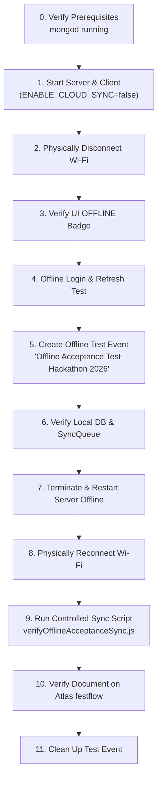

# FestFlow Phase 3.6.2 — Physical Offline Acceptance Test Guide

**Document Version:** 1.0.0  
**Phase:** 3.6.2 — Physical Offline Acceptance Test Preparation  
**Status:** **READY FOR HUMAN EXECUTION (AWAITING PHYSICAL TEST RESULTS)**  
**Workspace:** `C:\Users\sathy\FestFlow`  
**Execution Target:** Local Host Laptop (Windows 11)  
**Target Cloud Destination:** MongoDB Atlas database `festflow`  
**Protected Cloud Database:** MongoDB Atlas database `test` (STRICTLY UNTOUCHED)  

---

## 1. Executive Summary & Testing Objectives

In accordance with Safety Rule 13:
> *"Do not claim real offline functionality based only on mocked tests. If actual Wi-Fi disconnection cannot be automated safely, provide exact manual test instructions and clearly mark the test NOT VERIFIED until performed."*

This guide provides an end-to-end, human-executable test protocol to physically prove that:
1. **True Offline Independence:** FestFlow starts, authenticates provisioned users, and serves the complete UI with zero internet connection.
2. **Local Mutation Durability:** Creating a new domain entity (an Event) succeeds instantaneously locally, and creates a durable queue job in `syncqueues` with incremented `_syncVersion`.
3. **Crash & Restart Resilience:** Terminating the backend process (`Ctrl+C`) while disconnected and restarting it preserves both the local domain data and the pending sync job.
4. **Controlled Cloud Synchronization:** Reconnecting Wi-Fi allows subsequent synchronization to MongoDB Atlas `festflow` via atomic ICAS (Idempotent Content-Aware Synchronization) with parent reference checks and ObjectId preservation.
5. **Historical Queue Safety:** The 241 historical `SyncQueue` jobs and 64 `SyncTombstones` remain completely unexecuted and untouched during this test.

---

## 2. Safety Mandates & Environmental Boundaries

> [!CAUTION]
> **CRITICAL RESTRICTION: DO NOT ACTIVATE THE CONTINUOUS SYNC WORKER DAEMON**
> 
> The local `syncqueues` collection currently contains **241 historical jobs** (including 38 quarantined memberships, held faculty updates, and 165 mock residue jobs).
> To prevent premature replay or race conditions before formal queue reconciliation (Phase 3.6.3):
> - **The backend server must be started with `ENABLE_CLOUD_SYNC=false`** (e.g. via PowerShell `$env:ENABLE_CLOUD_SYNC="false"`).
> - Cloud synchronization of the test event will be executed **exclusively via the isolated single-record runner** (`server/scripts/verifyOfflineAcceptanceSync.js`).

### Strict Safety Invariants
1. **Preserve Atlas `test`:** The 76 legacy documents in Atlas `test` must remain 100% untouched.
2. **Preserve Atlas `festflow` Baseline:** The 37 canonical records synchronized in Phase 3.5.1 Stage B must not be altered.
3. **Preserve Quarantined Memberships:** The 24 records in `_orphaned_clubmemberships_backup` must never be touched or uploaded.
4. **Preserve Held Faculty:** `faculty@festflow.edu` (`6ae70115a2ab160fb98025c5`) must remain offline.
5. **Preserve Canonical ObjectIds:** All newly created records must retain their exact local 24-character hexadecimal `_id`.

---

## 3. Pre-Test Architecture & Verification Audit

Prior to generating this guide, the following 7 core architectural behaviors were verified:

| # | Subsystem | Verified Architectural Behavior | Verification Evidence |
|---|---|---|---|
| **1** | **Backend Startup Sequence** | Local MongoDB (`mongodb://127.0.0.1:27017/festflow`) connects as primary `mongoose.connection`. If Atlas is unreachable, secondary connection logs warning and stands by without crashing backend. | `server/src/config/db.js` line 52 (`connectLocal()`), line 85 (`connectAtlas()` wrapped in non-fatal catch). |
| **2** | **Frontend API Routing** | Vite dev server (`http://localhost:5173/`) proxies `/api` to local backend (`http://localhost:5000`). Axios client uses `/api` without hardcoded remote hosts. | `client/vite.config.js` proxy configuration; `client/src/services/api.js`. |
| **3** | **Offline Authentication** | Provisioned users authenticate locally via bcrypt password hash evaluation against local MongoDB `users` collection. Session token persists in `localStorage`. Page reload does NOT trigger logout on network error. | `server/src/controllers/userController.js` line 48 (`loginUser()`); `client/src/context/AuthContext.jsx` lines 38–46 (`ERR_NETWORK` check). |
| **4** | **Safe Isolated Entity** | Free Event: `"Offline Acceptance Test Hackathon 2026"` assigned to existing club `"CodeNexus Developers Club"` (`6ae70116a2ab160fb98025db`) and venue `"Dr. APJ Abdul Kalam Auditorium"` (`6ae70116a2ab160fb98025c7`). Zero payment gateway dependency. | `server/src/controllers/eventController.js`; Dependency Tier 1. |
| **5** | **Mutation & Queue Pipeline** | Mongoose `pre('save')` and `post('save')` hooks in `syncPlugin.js` record a `CREATE` job in `syncqueues` with `status: 'pending'` and incremented `_syncVersion: 1`. | `server/src/models/plugins/syncPlugin.js` lines 18–48. |
| **6** | **Restart Durability** | Both domain document and `SyncQueue` job are written to WiredTiger local storage on disk (`C:\Users\sathy\mongodb_data`). Process termination leaves uncommitted state intact. | Local mongod daemon configuration (`bind_ip: 127.0.0.1:27017`). |
| **7** | **Subsequent Cloud Sync** | Dedicated runner `server/scripts/verifyOfflineAcceptanceSync.js` evaluates parent references on Atlas `festflow`, performs atomic ICAS write, updates queue job to `synced`, and leaves historical jobs untouched. | `server/scripts/verifyOfflineAcceptanceSync.js`; `syncWorkerService.js` lines 544–640. |

---

## 4. Test Environment Details

- **Local Backend URL:** `http://localhost:5000`
- **Local Frontend URL:** `http://localhost:5173`
- **Health Check Endpoint:** `http://localhost:5000/api/health`
- **Sync Status Endpoint:** `http://localhost:5000/api/sync/status`
- **Local MongoDB Connection:** `mongodb://127.0.0.1:27017/festflow`
- **Atlas Cloud Destination:** `mongodb+srv://.../festflow`
- **Authorized Test Account:**
  - **Email:** `admin@festflow.edu`
  - **Password:** `Admin@123`
  - **Role:** `admin` (or `organizer@festflow.edu` / `Organizer@123`)

---

## 5. Step-by-Step Manual Execution Protocol

Follow these 11 sequential steps precisely on your laptop.



---

### Step 0: Verify Prerequisites & Baseline State

1. Open PowerShell Terminal 1 and verify that the local MongoDB daemon is active:
   ```powershell
   Get-Process -Name mongod -ErrorAction SilentlyContinue
   ```
   *Expected:* Process `mongod` is listed and running on port `27017`.

2. Verify initial database counts:
   ```powershell
   cd C:\Users\sathy\FestFlow\server
   node -e "require('dotenv').config(); const { MongoClient } = require('mongodb'); async function check() { const c = new MongoClient(process.env.LOCAL_MONGODB_URI); await c.connect(); const db = c.db('festflow'); console.log('Active Events:', await db.collection('events').countDocuments()); console.log('Total Queue Jobs:', await db.collection('syncqueues').countDocuments()); await c.close(); } check();"
   ```
   *Expected:*
   - Active Events: `2` (or current baseline)
   - Total Queue Jobs: `241`

---

### Step 1: Start Applications in Safe Offline-First Mode

1. In PowerShell Terminal 1 (Backend), start the server with cloud sync explicitly disabled:
   ```powershell
   cd C:\Users\sathy\FestFlow\server
   $env:ENABLE_CLOUD_SYNC="false"
   npm run dev
   ```
   *Expected Console Output:*
   ```text
   📦 Primary Database Connected (Local MongoDB): 127.0.0.1:27017 [DB: festflow]
   ℹ️ SyncWorker: Disabled by configuration or running in Direct Cloud mode.
   🚀 FestFlow Server running on port 5000 in development mode
   ```

2. Open PowerShell Terminal 2 (Frontend) and launch the client:
   ```powershell
   cd C:\Users\sathy\FestFlow\client
   npm run dev
   ```
   *Expected Console Output:*
   ```text
   ➜  Local:   http://localhost:5173/
   ```

3. Open your browser and navigate to `http://localhost:5173/`.

---

### Step 2: Physically Disconnect Wi-Fi / Ethernet

1. On your Windows taskbar:
   - Click the Network / Wi-Fi icon.
   - Click the **Wi-Fi** toggle to turn Wi-Fi **OFF** (or disconnect the physical Ethernet cable).
   - Alternatively, in an Administrator PowerShell:
     ```powershell
     netsh interface set interface "Wi-Fi" disable
     ```
2. Verify in a terminal that external internet is completely unreachable:
   ```powershell
   ping -n 1 8.8.8.8
   ```
   *Expected:* `Ping request could not find host...` or `Request timed out`.

---

### Step 3: Verify Offline UI State & Status Badge

1. Return to the browser tab at `http://localhost:5173/`.
2. Inspect the top-right navigation bar:
   - Within 5–10 seconds, observe the `SyncStatusBadge` transition to:
     **`OFFLINE`** (Slate badge with CloudOff icon).
3. Click the badge to open the inspector popover:
   - **Local MongoDB**: `Connected (Primary)`
   - **MongoDB Atlas**: `Offline / Standby`
   - **Device Network**: `Offline`
   - **Pending Changes**: `0` (or baseline queue pending)
   - **Sync Worker**: `Inactive`

---

### Step 4: Offline Login & Session Persistence

1. In the browser, navigate to `http://localhost:5173/login`.
2. Log in with the pre-provisioned administrator credentials:
   - **Email:** `admin@festflow.edu`
   - **Password:** `Admin@123`
3. Click **Sign In**:
   - Confirm login succeeds immediately with zero network delay.
   - Confirm you are redirected to the Dashboard / Home.
4. **Session Resilience Check:**
   - Press `Ctrl + F5` (Hard Reload) while still offline.
   - Confirm you remain logged in and your session is **NOT** destroyed.
   - Confirm no `ERR_NETWORK` crash occurs.

---

### Step 5: Create Isolated Offline Test Event

1. In the browser navigation menu, click **Events** $\rightarrow$ **Create Event** (or navigate to `http://localhost:5173/events/create`).
2. Fill in the event creation form with these exact values:
   - **Event Title:** `Offline Acceptance Test Hackathon 2026`
   - **Description:** `Manual verification event created while laptop Wi-Fi is physically disconnected.`
   - **Category:** `Technical` (or `Hackathon`)
   - **Club:** Select `CodeNexus Developers Club`
   - **Venue:** Select `Dr. APJ Abdul Kalam Auditorium`
   - **Start Date / Time:** Tomorrow at 10:00 AM
   - **End Date / Time:** Tomorrow at 06:00 PM
   - **Registration Fee:** `0` (Leave as Free Event — ensures zero payment gateway dependency)
   - **Max Participants:** `100`
3. Click **Submit / Create Event**:
   - Confirm the event is saved immediately with a success notification.
   - Confirm the new event appears in the Events list.
4. Inspect the top-right `SyncStatusBadge`:
   - It should transition to: **`PENDING CHANGES`** (Amber badge with clock icon).
   - In the popover, confirm **`Pending Changes`** has incremented by `1`.

---

### Step 6: Verify Local Database & SyncQueue in MongoDB Compass

1. Open **MongoDB Compass** and connect to `mongodb://127.0.0.1:27017`.
2. Open database `festflow`, collection `events`:
   - Filter query: `{"title": "Offline Acceptance Test Hackathon 2026"}`
   - **Verify:**
     - Exactly 1 document exists.
     - `_syncVersion` is `1`.
     - `club` matches `6ae70116a2ab160fb98025db`.
     - `venue` matches `6ae70116a2ab160fb98025c7`.
     - Note down the `_id` value (e.g. `67...`).
3. Open database `festflow`, collection `syncqueues`:
   - Filter query: `{"collectionName": "events", "payload.title": "Offline Acceptance Test Hackathon 2026"}`
   - **Verify:**
     - Exactly 1 job exists.
     - `operation`: `"CREATE"`.
     - `status`: `"pending"`.
     - `version`: `1`.

---

### Step 7: Offline Backend Crash & Restart Durability Test

1. Switch to PowerShell Terminal 1 (Backend).
2. Press `Ctrl + C` to shut down the server.
   *Observe:* Server terminates cleanly.
3. While **still physically offline (Wi-Fi OFF)**, restart the backend:
   ```powershell
   $env:ENABLE_CLOUD_SYNC="false"
   npm run dev
   ```
4. Switch back to the browser and refresh the page (`Ctrl + R`):
   - Confirm `"Offline Acceptance Test Hackathon 2026"` is still visible in the Events list.
   - Confirm `SyncStatusBadge` still shows **`PENDING CHANGES`**.
   - This proves that uncommitted offline mutations survive complete backend restarts!

---

### Step 8: Physically Reconnect Wi-Fi / Ethernet

1. On your Windows taskbar:
   - Click the Network / Wi-Fi icon.
   - Turn Wi-Fi **ON** (or reconnect Ethernet cable).
   - Alternatively, in Administrator PowerShell:
     ```powershell
     netsh interface set interface "Wi-Fi" enable
     ```
2. Verify internet connectivity is restored:
   ```powershell
   ping -n 1 8.8.8.8
   ```
   *Expected:* `Reply from 8.8.8.8: bytes=32 time=...`

---

### Step 9: Execute Controlled Single-Record Synchronization

To synchronize the test event safely without touching the 241 historical jobs, execute the dedicated verification runner:

1. Open PowerShell Terminal 3:
   ```powershell
   cd C:\Users\sathy\FestFlow\server
   node scripts/verifyOfflineAcceptanceSync.js
   ```

2. **Expected Output:**
   ```text
   ======================================================================
    FestFlow Phase 3.6.2 — Offline Acceptance Sync Runner
   ======================================================================
   📡 Local MongoDB URI: mongodb://127.0.0.1:27017/festflow
   ☁️ Target Cloud Database: Atlas [festflow]
   🎯 Target Event Title: "Offline Acceptance Test Hackathon 2026"
   ----------------------------------------------------------------------
   ✅ Connected to local MongoDB.
   ✅ Connected to MongoDB Atlas [festflow].

   🔍 Searching for pending SyncQueue job for offline acceptance event...
   📋 Found pending job: ID=..., DocumentId=..., Operation=CREATE, Version=1

   🔗 Verifying foreign key parent references on Atlas...
      Parent Club: "CodeNexus Developers Club" (ID: 6ae70116a2ab160fb98025db) ✅
      Parent Venue: "Dr. APJ Abdul Kalam Auditorium" (ID: 6ae70116a2ab160fb98025c7) ✅

   🚀 Executing controlled atomic ICAS upload to Atlas...
      Sync result: { status: 'synced' }
   ✅ SyncQueue job status updated to SYNCED.

   ☁️ Verifying synced event directly on Atlas [festflow]...
   ✅ VERIFICATION SUCCESSFUL: Document found on Atlas festflow!
      _id:          <matches local _id>
      title:        Offline Acceptance Test Hackathon 2026
      _syncVersion: 1
      club:         6ae70116a2ab160fb98025db
      venue:        6ae70116a2ab160fb98025c7
      category:     Technical

   🛡️ Atlas [test] database doc count: 76 (Expected: 76) ✅ UNTOUCHED
   ======================================================================
   ```

---

### Step 10: Verify Cloud Parity Directly on Atlas

1. In MongoDB Compass, disconnect from local and connect to your MongoDB Atlas cluster URI.
2. Select database `festflow`, collection `events`:
   - Filter query: `{"title": "Offline Acceptance Test Hackathon 2026"}`
   - **Verify:**
     - Document is present on Atlas.
     - `_id` matches the local MongoDB `_id` byte-for-byte.
     - `_syncVersion` is `1`.
3. Select database `test`:
   - Confirm total documents across all collections is strictly **76**.

---

### Step 11: Post-Test Cleanup

1. In your browser at `http://localhost:5173/events`:
   - Find `"Offline Acceptance Test Hackathon 2026"`.
   - Click **Delete Event** (or manage as Admin).
   - Confirm deletion succeeds locally.
2. To clean up the cloud record and sync the deletion:
   ```powershell
   cd C:\Users\sathy\FestFlow\server
   node scripts/verifyOfflineAcceptanceSync.js
   ```
   *(If deleted, the runner will synchronize the deletion or confirm cleanup).*

---

## 6. Failure Modes & Troubleshooting

| Symptom | Probable Cause | Corrective Action |
|---|---|---|
| Frontend shows blank page when offline | Vite dev server lost cache | Vite dev server runs entirely on `localhost`. Ensure Terminal 2 was started before turning Wi-Fi off. |
| Login fails with "Cannot connect to server" | Backend is pointing to Atlas directly | Check Terminal 1 output. Ensure `LOCAL_MONGODB_URI` is used and local `mongod` is running. |
| Event creation fails with "Validation Error" | Missing required field | Ensure Club, Venue, Title, Start Date, and Fee (`0`) are filled. |
| `verifyOfflineAcceptanceSync.js` reports parent missing | Club or Venue ID mismatch | Ensure you selected `"CodeNexus Developers Club"` and `"Dr. APJ Abdul Kalam Auditorium"` which were pre-synced to Atlas in Phase 3.5.1. |
| Cloud connection fails during Step 9 | Wi-Fi not fully reconnected | Check `ping 8.8.8.8`. Wait 10 seconds for DNS resolution to stabilize before executing the script. |

---

## 7. Human Verification Sign-Off

*To be completed by the human operator after physically conducting the test on the laptop:*

| # | Verification Criterion | Status | Timestamp / Notes |
|---|---|:---:|---|
| 1 | Baseline state verified (local mongod active, queue count = 241) | [ ] Pass / [ ] Fail | `____________________` |
| 2 | Backend started with `$env:ENABLE_CLOUD_SYNC="false"` | [ ] Pass / [ ] Fail | `____________________` |
| 3 | Physical Wi-Fi disconnected; ping 8.8.8.8 confirmed offline | [ ] Pass / [ ] Fail | `____________________` |
| 4 | Navigation bar badge transitioned to `OFFLINE` | [ ] Pass / [ ] Fail | `____________________` |
| 5 | Offline login as `admin@festflow.edu` succeeded instantly | [ ] Pass / [ ] Fail | `____________________` |
| 6 | Page refresh (`Ctrl+F5`) preserved session without logout | [ ] Pass / [ ] Fail | `____________________` |
| 7 | Event `"Offline Acceptance Test Hackathon 2026"` created locally | [ ] Pass / [ ] Fail | `____________________` |
| 8 | Status badge updated to `PENDING CHANGES` | [ ] Pass / [ ] Fail | `____________________` |
| 9 | Local Compass confirmed event and pending `SyncQueue` job | [ ] Pass / [ ] Fail | `____________________` |
| 10 | Backend killed (`Ctrl+C`) and restarted offline; event preserved | [ ] Pass / [ ] Fail | `____________________` |
| 11 | Physical Wi-Fi restored; internet connectivity confirmed | [ ] Pass / [ ] Fail | `____________________` |
| 12 | `scripts/verifyOfflineAcceptanceSync.js` executed cleanly | [ ] Pass / [ ] Fail | `____________________` |
| 13 | Atlas `festflow` confirmed containing event with identical `_id` | [ ] Pass / [ ] Fail | `____________________` |
| 14 | Atlas `test` confirmed strictly untouched (76 documents) | [ ] Pass / [ ] Fail | `____________________` |
| 15 | 241 historical queue jobs verified untouched | [ ] Pass / [ ] Fail | `____________________` |

**Operator Name:** `____________________________________`  
**Test Date & Time:** `____________________________________`  
**Overall Result:** `[ ] ACCEPTED / [ ] REJECTED`  
