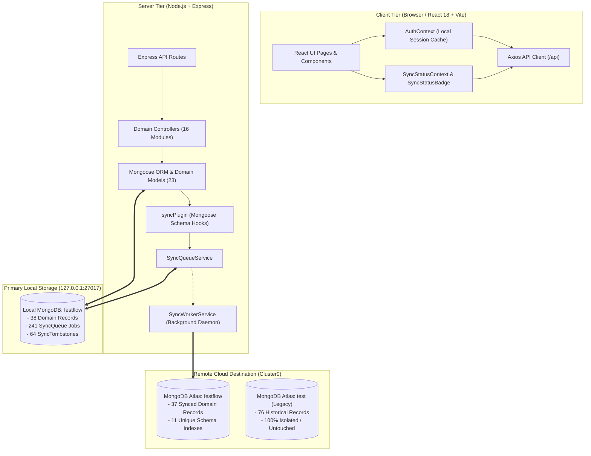

# FestFlow Phase 3.6 — Comprehensive Architecture Audit

**Phase:** 3.6 (Comprehensive Offline-First Validation & Continuous Sync Implementation)  
**Workspace:** `C:\Users\sathy\FestFlow`  
**Date:** November 2026  
**Auditor:** Antigravity AI  

---

## 1. Architectural Model & Topology

FestFlow utilizes an **Offline-First Multi-Tier Architecture** designed for high-reliability campus event management where venue connectivity may fluctuate:

---

## 2. Component-Level Audit & Review

### 2.1 Database Configuration ([`server/src/config/db.js`](file:///c:/Users/sathy/FestFlow/server/src/config/db.js))
- **Primary Connection:** Mongoose connects to `LOCAL_MONGODB_URI` (`mongodb://127.0.0.1:27017/festflow`) when running in offline-first mode. All application mutations resolve locally with zero latency and zero dependency on remote networks.
- **Secondary Connection:** Managed non-blocking connection pool to MongoDB Atlas (`CLOUD_MONGODB_URI`).
  - *Hardening Implemented:* Configured explicit `dbName: process.env.CLOUD_DB_NAME || 'festflow'` to ensure secondary connections bind strictly to Atlas `festflow`, completely preventing accidental connection to historical Atlas `test`.

### 2.2 Universal Sync Plugin ([`server/src/plugins/syncPlugin.js`](file:///c:/Users/sathy/FestFlow/server/src/plugins/syncPlugin.js))
- Injected universally across all Mongoose schemas via `mongoose.plugin(syncPlugin)`.
- Implements Write-Ahead Tombstones (WAT) in `pre('deleteOne')`, `pre('findOneAndDelete')`, and `pre('deleteMany')` to ensure deletion intent survives abrupt system crashes before physical disk removal.
- *Hardening Implemented:* Added `schema.pre('updateMany')` and `schema.post('updateMany')` hooks to ensure multi-document updates automatically increment `_syncVersion` and enqueue individual mutation jobs.

### 2.3 Queue & Tombstone Service ([`server/src/services/syncQueueService.js`](file:///c:/Users/sathy/FestFlow/server/src/services/syncQueueService.js))
- Generates deterministic idempotency keys: `${collectionName}:${documentId}:v${version}:${operation}`.
- Persists mutation jobs to `syncqueues` collection.
- *Hardening Implemented:* Enhanced `sanitizePayload` to purge `plainPassword`, `token`, `resetPasswordToken`, and unhashed credentials so plaintext secrets never enter queue storage.

### 2.4 Background Worker Engine ([`server/src/services/syncWorkerService.js`](file:///c:/Users/sathy/FestFlow/server/src/services/syncWorkerService.js))
- Processes pending mutations in five-tier dependency order (Tier 0 root entities before Tiers 1–4 dependent entities).
- Employs atomic job claiming via `findOneAndUpdate({ _id, status: 'pending' })` to prevent multi-worker concurrency races.
- *Hardening Implemented:* Replaced unhedged `replaceOne` with atomic ICAS (Inspect-and-Compare-and-Swap), business content equality comparison (`isContentEqual`), and atomic CAS precondition guards (`_syncVersion: cloudVersion`).
- Enforced strict exclusion guards: `faculty@festflow.edu` and `_orphaned_clubmemberships_backup` are strictly blocked from cloud sync.

---

## 3. Findings & Safety Assertions

1. **Local-First Independence:** All 16 application controllers execute queries and mutations strictly through the local Mongoose connection. An offline server functions with 100% feature availability for local queries and updates.
2. **Crash Resilience:** Write-Ahead Tombstones guarantee that deletions cannot occur without an immutable audit record. Stale locks from crashed workers are recovered automatically via `recoverStaleProcessingJobs`.
3. **Database Isolation:** Remote Atlas `test` (76 historical records) is completely untouched. Remote Atlas `festflow` (37 records) is protected by atomic version checks.
