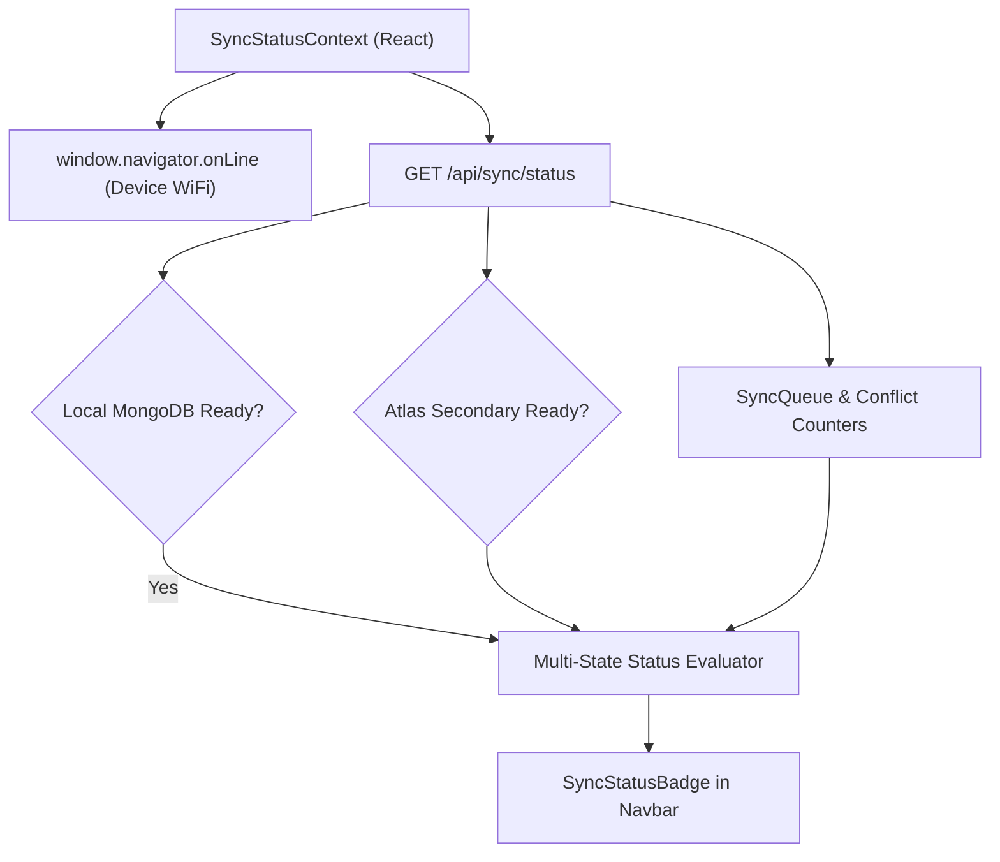

# FestFlow Phase 3.6 — Connectivity Detection & Frontend Status Report

**Milestone:** Phase 3.6 Workstream 5  
**Components Created/Modified:**  
- Backend: [`server/src/server.js`](file:///c:/Users/sathy/FestFlow/server/src/server.js) (`/api/sync/status`)  
- Context: [`client/src/context/SyncStatusContext.jsx`](file:///c:/Users/sathy/FestFlow/client/src/context/SyncStatusContext.jsx)  
- Component: [`client/src/components/SyncStatusBadge.jsx`](file:///c:/Users/sathy/FestFlow/client/src/components/SyncStatusBadge.jsx)  
- UI Integration: [`client/src/components/Navbar.jsx`](file:///c:/Users/sathy/FestFlow/client/src/components/Navbar.jsx)  
- App Root: [`client/src/App.jsx`](file:///c:/Users/sathy/FestFlow/client/src/App.jsx)  

---

## 1. Dual-Health Connectivity Architecture

Rather than relying naively on browser `navigator.onLine` (which only indicates a local network link without guaranteeing cloud database reachability), FestFlow implements independent multi-tier health monitoring:

---

## 2. Status Transition Truth Table

The system resolves the UI indicator according to the following strict hierarchy:

| Condition | Resolved Status | Visual Badge Styling | Popover Description |
| :--- | :---: | :---: | :--- |
| `queueStats.unresolvedConflicts > 0` | **`CONFLICT`** | Red (`bg-red-500/10`, pulsing dot) | Unresolved data conflict requiring admin attention |
| `queueStats.failed > 0` | **`SYNC ERROR`** | Amber (`bg-amber-500/10`, alert icon) | One or more sync mutations exceeded retry limit |
| `queueStats.processing > 0` | **`SYNCING`** | Blue (`bg-blue-500/10`, rotating spinner) | Background sync worker actively processing a batch |
| `cloudAtlasReady === true && pending > 0` | **`SYNCING`** | Blue (`bg-blue-500/10`, rotating spinner) | Cloud connected; pending mutations queued for upload |
| `cloudAtlasReady === false && pending > 0` | **`PENDING CHANGES`** | Amber (`bg-amber-500/10`, clock icon) | Offline mode; durable local changes waiting for internet |
| `cloudAtlasReady === true && pending === 0` | **`SYNCED`** | Emerald (`bg-emerald-500/10`, checkmark) | All local changes confirmed persisted to Atlas `festflow` |
| `cloudAtlasReady === false && pending === 0` | **`OFFLINE`** | Slate (`bg-slate-500/10`, cloud-off icon) | Running on local MongoDB; 0 pending cloud changes |
| `localDbReady === false` | **`OFFLINE`** | Slate (`bg-slate-500/10`, alert) | Local server / database connection unreachable |

---

## 3. UI Component Design & Non-Disruptive Placement

1. **Compact Navbar Pill:**  
   The `SyncStatusBadge` is positioned cleanly inside the top-right navigation bar of `Navbar.jsx` adjacent to user profile details.
2. **Interactive Popover Inspector:**  
   Clicking the badge opens a detailed popover displaying:
   - **Local MongoDB**: Connection status (Primary).
   - **MongoDB Atlas**: Cloud reachability status (Destination).
   - **Device Network**: Browser WiFi/Ethernet status.
   - **Pending Changes**: Real-time queue count.
   - **Conflicts & Errors**: Active conflict and failure counts.
   - **Manual Refresh Button**: One-click status re-evaluation without reloading the page.
3. **Build Parity:**  
   Production build compiled cleanly via `npm run build` in **10.80 seconds** with zero Vite or Tailwind warnings.
