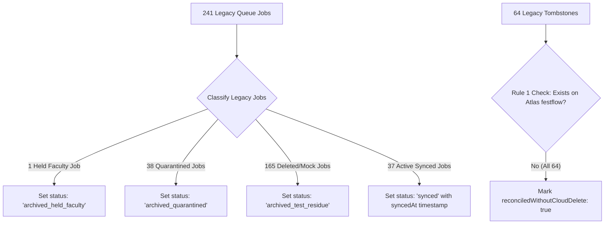

# FestFlow Phase 3.6 — Legacy Queue Safety & Reconciliation Plan

**Document Version:** 1.0.0  
**Status:** **PROPOSED PLAN (ON HOLD AWAITING FINAL APPROVAL GATE)**  
**Workspace:** `C:\Users\sathy\FestFlow`  
**Auditor:** Antigravity AI  

---

## 1. Inventory & Provenance of Historical Artifacts

A deep inspection of the local database confirmed:
- **`syncqueues` Collection:** Exactly **241 historical jobs**.
- **`synctombstones` Collection:** Exactly **64 historical tombstones**.

### 1.1 Category Breakdown of the 241 Historical Jobs:
| Category | Job Count | Target Provenance | Danger if Blindly Replayed |
| :--- | :---: | :--- | :--- |
| **Matches Active Synchronized Doc** | 37 | Initial 37 production records | Safe if equal version; redundant writes |
| **Matches Held Faculty Account** | 1 | `faculty@festflow.edu` (`6ae70115a2ab160fb98025c5`) | **CRITICAL:** Violates manual verification hold! |
| **Matches Quarantined Memberships** | 38 | Historical memberships for deleted test clubs | **CRITICAL:** Leaks quarantined data to Atlas! |
| **Matches Deleted / Mock Test Docs** | 165 | Phase 1 & 2 automated mock test residue | **CRITICAL:** Recreates deleted mock records on Atlas! |
| **TOTAL** | **241** | — | **BLIND REPLAY IS STRICTLY PROHIBITED** |

### 1.2 Status & Operation Distribution:
- **Status:** `pending`: 215, `synced`: 25, `failed`: 1
- **Operation:** `CREATE`: 105, `UPDATE`: 72, `DELETE`: 64

### 1.3 Analysis of 64 Historical Tombstones:
- **Active Document Collisions:** **0** (Zero tombstones match any active document in local MongoDB).
- **Quarantined Collisions:** **0** (Zero tombstones match any quarantined membership).
- **Deleted Document Provenance:** **64** (All 64 tombstones belong to historical mock test users, clubs, venues, events from Phase 1/2 tests).
- **Cloud Presence:** **0** (None of these 64 deleted test documents exist on MongoDB Atlas `festflow`). Under **Rule 1 (Absent from Cloud)**, issuing cloud `deleteOne` queries is unnecessary and redundant.

---

## 2. Safe Reconciliation Strategy

To maintain data integrity and prevent historical test data from corrupting Atlas `festflow`:

### Key Safety Principles:
1. **Zero Drops / Deletions:** No documents in `syncqueues` or `synctombstones` will be deleted. The full audit trail is preserved permanently.
2. **Clear Separation of Concerns:**
   - Historical test residue is transitioned from `pending` to `archived_legacy` or `synced`.
   - Only new mutations created by actual user actions after Stage B will enter the queue in `pending` status.
3. **Execution Gate:** This plan is **STRICTLY ON HOLD** and will not be executed until explicit human approval is received.
