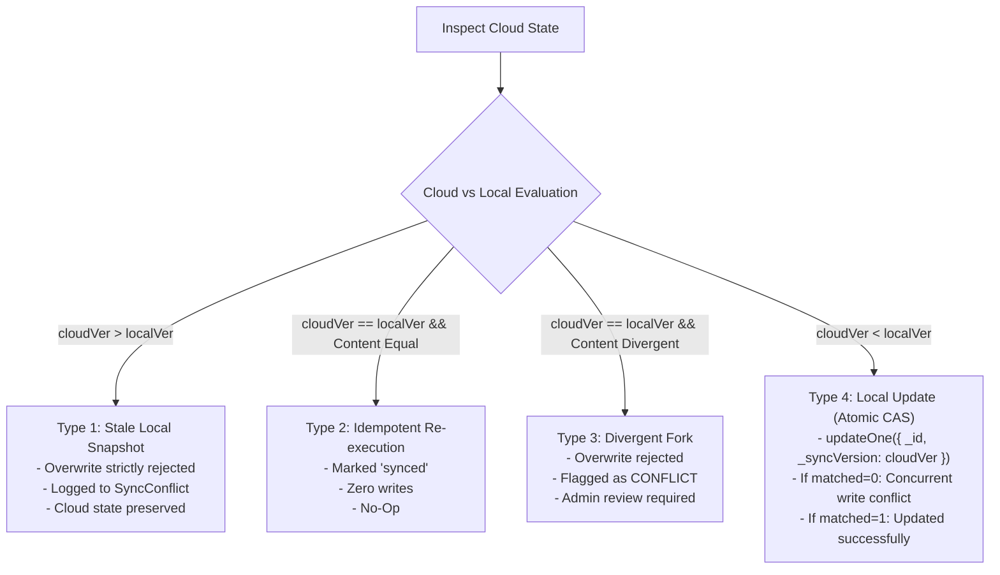

# FestFlow Phase 3.6 — Recovery & Conflict Architecture Report

**Milestone:** Phase 3.6 Workstream 6  
**Auditor / Agent:** Antigravity AI  
**Scope:** Edge Cases, Concurrency Collisions, Network Timeouts, and Recovery Protocols  

---

## 1. Conflict & Collision Taxonomy

The hardened FestFlow synchronization engine recognizes and safely resolves four distinct conflict topologies:

---

## 2. Recovery Protocols Implemented & Tested

### 2.1 Stale Processing Lock Recovery (`recoverStaleProcessingJobs`)
- **Vulnerability:** If the Node.js server crashes abruptly during an active sync batch, claimed jobs remain locked in `status: 'processing'` indefinitely.
- **Recovery Protocol:** On worker startup and at periodic intervals, the worker queries `syncqueues` for jobs where `status === 'processing'` and `processingStartedAt` is older than `staleLockTimeoutMs` (default: 5 minutes).
- **Tested Behavior:** Automatically resets orphaned processing jobs to `pending` and increments `retryCount`. Tested and confirmed passing in Test 7.

### 2.2 Duplicate-Key Race Recovery (`E11000`)
- **Vulnerability:** When a record does not exist on Atlas during initial inspection, a concurrent worker might insert the same document between `findOne` and `insertOne`.
- **Recovery Protocol:** The worker catches `insertErr.code === 11000`, re-reads `cloudDoc = await atlasColl.findOne({ _id: documentId })`, and seamlessly re-evaluates the document through the ICAS version engine rather than crashing.

### 2.3 Atomic CAS Precondition Guard
- **Vulnerability:** If Atlas is modified between the worker's `findOne` inspection and `replaceOne` mutation, an unguarded replace would overwrite the intervening cloud modification.
- **Recovery Protocol:** The atomic filter `{ _id: documentId, _syncVersion: cloudVersion }` guarantees the update only applies if the remote document version is exactly what the worker evaluated. If `matchedCount === 0`, it records a concurrent collision in `SyncConflict` and halts overwrite.

### 2.4 Parent Dependency Hold & Deferral
- **Vulnerability:** Ingesting child entities (e.g. `expenses`, `judgescores`) before their required parent (`budgets`, `competitions`) exist on Atlas triggers foreign key constraint failures.
- **Recovery Protocol:** `isParentReadyForChild` queries Atlas before claiming child jobs. If the parent is missing from Atlas or has a pending/failed job in `SyncQueue`, the child is deferred to the next polling cycle without burning retry counts. Tested and confirmed passing in Test 13.
