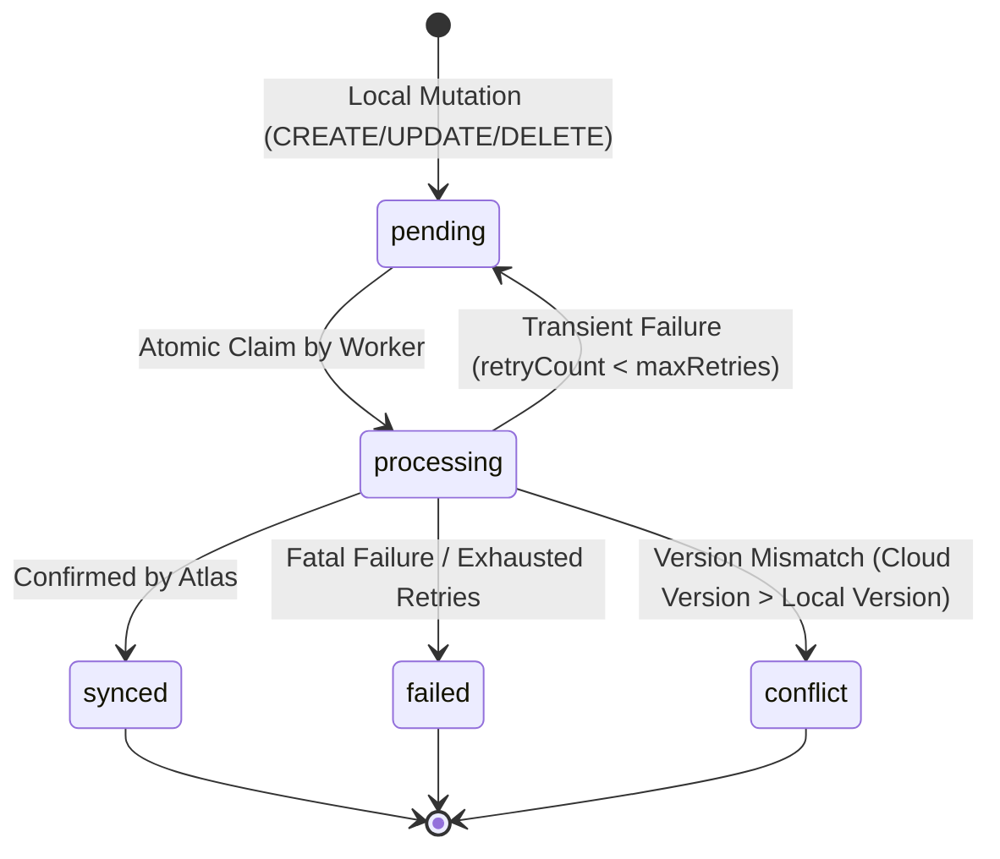

# FestFlow Phase 3.1 Implementation Plan: Background Sync Worker Foundation

**Project:** FestFlow Offline-First Full-Stack System  
**Target Directory:** `C:\Users\sathy\FestFlow`  
**Scope:** Phase 3.1 Background Sync Worker Foundation  
**Mode:** Local Standalone MongoDB (`mongodb://127.0.0.1:27017/festflow`) to Cloud Atlas (`CLOUD_MONGODB_URI`)  
**Date:** 2026-11-01  

---

## 1. Architectural Overview

FestFlow's offline-first architecture designates **Local MongoDB** as the primary datastore for all application traffic, operational workloads, and immediate UI responses. **MongoDB Atlas** serves as the remote synchronization and cloud backup destination.

```mermaid
flowchart LR
    subgraph Local["Local Machine (Offline-Capable)"]
        Client["Web Frontend / API Clients"] --> Express["Express Controllers"]
        Express --> LocalDB[("Primary Local MongoDB\n(festflow)")]
        LocalDB --> Plugin["Mongoose syncPlugin"]
        Plugin --> SyncQueue[("SyncQueue\n(syncqueues)")]
        Plugin --> SyncTomb[("SyncTombstone\n(synctombstones)")]
        Worker["SyncWorkerService\n(Background Poller)"] -->|Poll & Claim| SyncQueue
        Worker -->|Look up| SyncTomb
    end

    subgraph Cloud["Remote Cloud"]
        Worker -->|Native Driver Operations\n(Atlas Secondary Conn)| AtlasDB[("MongoDB Atlas Cluster\n(festflow)")]
    end
```

The Phase 3.1 Background Sync Worker (`server/src/services/syncWorkerService.js`) bridges the persistent local queue (`SyncQueue`) and MongoDB Atlas via non-blocking, idempotent, rate-limited batch processing.

---

## 2. Worker Lifecycle & Atomic Job Claiming

### 2.1 State Machine



### 2.2 Atomic Job Claiming & Concurrency Protection
To prevent race conditions and double-processing:
1. The worker fetches eligible job IDs ordered by dependency tier, creation time, and version.
2. For each job, it executes an atomic claim:
   ```javascript
   const job = await SyncQueue.findOneAndUpdate(
     { _id: jobId, status: 'pending' },
     { $set: { status: 'processing', processingStartedAt: new Date() } },
     { new: true }
   );
   ```
3. If another worker or process claimed the job concurrently, `findOneAndUpdate` returns `null` and the worker skips it safely.

### 2.3 Stale Processing Recovery (Crash Resilience)
If the server or worker crashes mid-batch:
- Jobs left in `processing` (or `in_progress`) with `processingStartedAt` older than `LOCK_TIMEOUT_MS` (e.g. 5 minutes), or from previous process lifecycles, are reset to `pending` during worker initialization and periodic maintenance:
  ```javascript
  await SyncQueue.updateMany(
    {
      status: { $in: ['processing', 'in_progress'] },
      $or: [
        { processingStartedAt: { $lt: new Date(Date.now() - lockTimeoutMs) } },
        { processingStartedAt: null }
      ]
    },
    { $set: { status: 'pending' }, $inc: { retryCount: 1 } }
  );
  ```

---

## 3. Database Connection & Access Strategy

### 3.1 Isolation from Local Mongoose Models
- In `server/src/config/db.js`, the secondary Atlas connection is established via `mongoose.createConnection(cloudUri)`.
- The global `syncPlugin` is hooked onto `mongoose` (the primary local connection).
- **Rule**: The worker **NEVER** executes Atlas operations using the primary Mongoose models (e.g. `User.updateOne(...)`). Doing so would write to local MongoDB and re-trigger local hooks.
- **Implementation**: The worker obtains the secondary connection via `connectDB.getAtlasConnection()` and accesses collections directly using the native MongoDB Collection API:
  ```javascript
  const atlasColl = atlasConn.collection(collectionName);
  ```
  This ensures:
  1. Direct, low-overhead native execution against Atlas.
  2. Complete immunity from local Mongoose middleware loops.
  3. Absolute preservation of ObjectIds, nested documents, and timestamps.

### 3.2 Connectivity & Offline Safety
- Before processing any batch, the worker verifies `connectDB.isAtlasConnected()`.
- If Atlas is disconnected or reconnecting, the worker idles cleanly without throwing errors or halting the Express server.
- If an I/O or network exception occurs during upload, the affected job transitions from `processing` to `pending`, incrementing `retryCount` and storing sanitized `errorDetails`.

---

## 4. Atlas Upload Strategy & Conflict Handling

### 4.1 CREATE & UPDATE Mutations
1. Worker inspects Atlas for existing document:
   `const cloudDoc = await atlasColl.findOne({ _id: job.documentId });`
2. **Version Checks**:
   - **Newer on Cloud (`cloudDoc._syncVersion > job.version`)**:
     A concurrent cloud update occurred. The worker records a conflict in `SyncConflict` via `syncQueueService.recordConflict()`, updates the job status to `conflict`, and alerts administrators.
   - **Identical on Cloud (`cloudDoc._syncVersion === job.version`)**:
     The document is already at this version on Atlas (e.g. prior unacknowledged attempt). The worker marks the job as `synced` idempotently.
   - **Local Newer or Cloud Document Missing (`version > cloudVersion` or `!cloudDoc`)**:
     The worker executes an idempotent upsert:
     ```javascript
     await atlasColl.replaceOne(
       { _id: job.documentId },
       job.payload,
       { upsert: true }
     );
     ```
     Once confirmed by Atlas (`result.acknowledged === true`), the job status updates to `synced` with `syncedAt: new Date()`.

### 4.2 DELETE Mutations
1. Worker queries Atlas for the target document:
   `const cloudDoc = await atlasColl.findOne({ _id: job.documentId });`
2. If `cloudDoc` exists and its version is strictly greater than `job.version`:
   - Document was recreated or modified on cloud after local deletion. Recorded in `SyncConflict`.
3. Otherwise:
   - Execute native deletion: `await atlasColl.deleteOne({ _id: job.documentId });`
   - Once confirmed, mark job as `synced`.

---

## 5. Dependency Ordering Map

Foreign key relationships between the 23 domain models dictate that parent entities must be uploaded prior to dependent child records:

```mermaid
flowchart TD
    subgraph Tier0["Tier 0: Root & Independent Entities"]
        T0_1["venues"]
        T0_2["sponsors"]
        T0_3["users"]
        T0_4["clubs"]
    end

    subgraph Tier1["Tier 1: Core Scoped Entities"]
        T1_1["events (ref: clubs, venues, users)"]
        T1_2["clubmemberships (ref: clubs, users)"]
    end

    subgraph Tier2["Tier 2: Event Subsystems"]
        T2_1["registrations (ref: events, users)"]
        T2_2["caterings (ref: events)"]
        T2_3["budgets (ref: events)"]
        T2_4["expenses (ref: events)"]
        T2_5["revenues (ref: events)"]
        T2_6["eventsponsors (ref: events, sponsors)"]
        T2_7["competitions (ref: events)"]
        T2_8["feedbacks (ref: events, users)"]
        T2_9["volunteers (ref: events, users)"]
        T2_10["certificates (ref: events, users)"]
    end

    subgraph Tier3["Tier 3: Secondary Dependent Entities"]
        T3_1["payments (ref: registrations, events, users)"]
        T3_2["teams (ref: competitions, users)"]
        T3_3["judges (ref: competitions)"]
        T3_4["judgingcriterias (ref: competitions)"]
        T3_5["prizes (ref: competitions)"]
    end

    subgraph Tier4["Tier 4: Deep Evaluation Entities"]
        T4_1["judgescores (ref: competitions, teams, judges, judgingcriterias)"]
        T4_2["results (ref: competitions, teams, prizes)"]
    end

    Tier0 --> Tier1
    Tier1 --> Tier2
    Tier2 --> Tier3
    Tier3 --> Tier4
```



### Dependency Failure Safety Rule
When fetching and processing batches:
1. Jobs are sorted by `dependencyTier ASC, createdAt ASC, version ASC`.
2. If an upload for a parent job (e.g. an `events` record) fails or encounters a conflict, any dependent child jobs in the batch (e.g. `registrations` or `payments` referencing that event) are **aborted/deferred** for that run cycle.
3. Dependent records remain `pending` until the parent record successfully transitions to `synced`.

---

## 6. Runtime-Mode Separation

| Mode | Trigger | Database Config | Worker Behavior |
| :--- | :--- | :--- | :--- |
| **Offline-First (Local)** | `isOfflineMode() === true` | Primary = Local MongoDB<br>Secondary = Atlas (optional) | Sync worker initializes and polls. Uploads when Atlas is connected. |
| **Direct Cloud (Render)** | `isOfflineMode() === false` | Primary = MongoDB Atlas | **Worker is completely disabled**. No local polling, no secondary connection, zero overhead. |

Configuration Settings:
- `ENABLE_CLOUD_SYNC` (default `true` in offline mode)
- `SYNC_INTERVAL_MS` (default `5000` ms)
- `SYNC_BATCH_SIZE` (default `25` jobs)
- `SYNC_MAX_RETRIES` (default `5` attempts)

---

## 7. Health & Observability Metrics

The `/api/health` endpoint is augmented with structured worker diagnostics:
```json
{
  "syncWorker": {
    "enabled": true,
    "running": true,
    "atlasConnected": true,
    "pendingCount": 4,
    "processingCount": 0,
    "failedCount": 0,
    "syncedCount": 42,
    "lastSyncTime": "2026-11-01T18:05:00.000Z",
    "lastError": null,
    "lastActivity": "2026-11-01T18:05:05.000Z"
  }
}
```
*Zero credentials, connection strings, or sensitive tokens are exposed in any telemetry output.*
